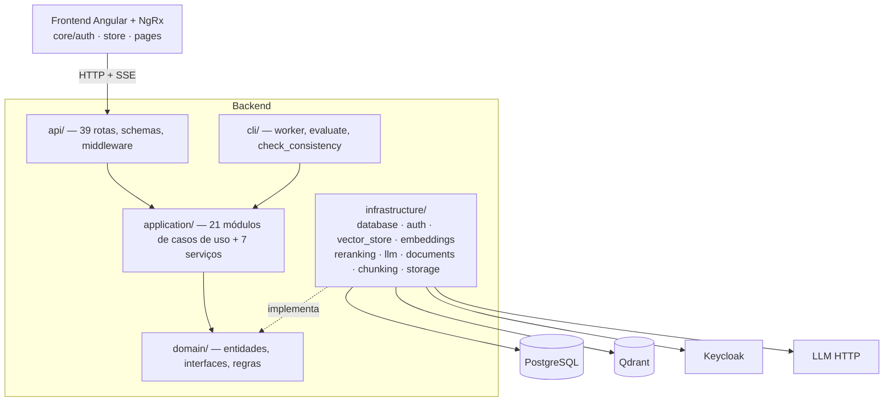

# Cartographer — Relatório final do Nexus

**Projeto:** `D:\Projects\nexus` · **Data:** 2026-10-13 · **Objetivo:** health check geral
**Escopo analisado:** 288 arquivos (backend Python 167, frontend TS 46, infra/scripts). Ignorados: `docs/`, `.cursor/`, `.claude/`. Testes usados só como sinal de intenção.
**Revisão por agentes:** 8 de 12 segmentos (os de maior complexidade e risco), cerca de 1,1 M de tokens de subagentes.

> **Como ler os níveis de confiança.** ✅ = conferi eu mesmo no código depois do revisor. 🔎 = achado do revisor, com `arquivo:linha`, mas não reconferido por mim. Revisores leem código; nenhum deles executou o sistema, então "pode causar" significa risco visto na leitura, não falha reproduzida.

---

## 1. Resumo executivo

O Nexus está **bem estruturado**: a camada de aplicação não importa infraestrutura nem API, a verificação do JWT é sólida (RS256 fixado, issuer, audience e expiração obrigatórios, JWKS em cache), o armazenamento bloqueia path traversal e os timestamps usam `timestamptz` de forma consistente. Os problemas concentram-se em **cinco temas**, todos de robustez, não de design:

1. **Histórico de conversa forjável** ✅ — `POST /conversations/{id}/messages` aceita `role=assistant` e `role=system`; o texto entra no histórico enviado ao LLM nas perguntas seguintes e não passa por limite de uso, acesso nem auditoria. Dois revisores chegaram a isso de lados diferentes. *(P0, correção pequena)*
2. **Jobs sem posse/lease** 🔎 — ingestão e reindexação têm reserva fixa de 600 s sem renovação nem verificação de dono nas atualizações. Um OCR demorado permite que dois workers processem o mesmo job e um apague o que o outro construiu no Qdrant. *(P0/P1)*
3. **Duas fontes de verdade sem atomicidade (Postgres × Qdrant)** 🔎 — aparece em cinco lugares independentes: ingestão, reindexação (falha após o swap de alias deixa o índice "desatualizado" e bloqueia uploads), restrição de grupos (corrida com reindex), exclusão de assistente e backup.
4. **Padrões de desenvolvimento que viram padrão de produção** ✅ — usuários do Keycloak com senha `nexus-dev` (`temporary:false`, inclusive o admin), segredos padrão públicos, e todas as portas (Postgres, Qdrant, Keycloak em `start-dev`, Prometheus…) publicadas em todas as interfaces. Nada falha na inicialização se os padrões continuarem. *(Se o compose for só local, rebaixe para P2; se alguém sobe isso em servidor, é P0.)*
5. **Streaming de chat frágil** 🔎 — no frontend, um stream que termina sem `done`/`error` deixa o spinner preso para sempre e não existe ação de cancelar; polling de documentos para após uma única falha; markdown do LLM permite `` remoto (canal de exfiltração via prompt injection).

Também relevante: uploads são lidos inteiros em memória **antes** de checar o tamanho ✅ (`documents.py:116,230`); listagens de conversa carregam todas as mensagens sem paginação 🔎; ~14 caminhos de escrita fazem `commit` sem `rollback` 🔎; subprocessos `.doc` (`antiword`/`soffice`) sem timeout 🔎.

## 2. Mapa (camadas, conforme a Clean Architecture do Nexus)

Diagramas gerados pelo plugin (dependência de arquivos, classes, pipelines por entrada, um cartão por endpoint) estão na pasta `.cartographer/`: `project-map.mmd`, `class_diagram.mmd`, `pipelines/`, `endpoints/`.

## 3. Inventário de segmentos

| Segmento | Revisor | Arquivos | LOC | Principal preocupação |
|---|---|---|---|---|
| rag-retrieval | ai-pipeline | 12 | 2,5k | pergunta fica órfã se a geração falha; ACL "fail-open" se `allowed_groups` ausente; defesa de prompt injection só registra |
| auth-access-control | auth-security | 13 | 2,1k | senha padrão do admin; grupos casados só pelo nome da folha; chave Fernet sem salt nem rotação |
| api-http | backend-api | 17 | 2,9k | upload em memória; role forjável; enumeração de IDs de assistente (404 antes de 403) |
| ingestion-and-worker | queue-worker | 17 | 3,2k | sem renovação de lease; subprocessos sem timeout; classificação de erro por tipo |
| database | db-schema | 14 | 2,4k | listagens sem paginação; commits sem rollback; índices ausentes; sem CHECK em status |
| application-use-cases | generalist | 28 | 5,1k | reindex não atômico; `chat_with_assistant.py` com 794 linhas; langgraph na camada de aplicação |
| frontend-core-store | frontend-ui | 36 | 5,5k | stream preso; refresh derruba a sessão em erro de rede; seletores instáveis |
| devops-infra | devops-config | 17 | 0,9k | defaults públicos; portas abertas; backup não consistente e restore não testado; imagens root |
| domain-and-dto, llm-and-evaluation, frontend-pages, observability | — | 54 | 8,3k | **não revisados** (ver §7) |

## 4. Achados transversais

Pontos que só aparecem cruzando relatórios:

- **Fronteira de transação.** Repositórios fazem `commit` por conta própria (database), então use cases não conseguem gravar auditoria + ação + grupos de forma atômica (auth, application). Um *Unit of Work* resolveria três achados de uma vez.
- **Exceções e HTTP.** Há "não encontrado" como `ValueError` e como `LookupError`, quatro formatos de erro nas rotas, `ValueError→422` para LLM não configurado e `502` com texto cru da exceção (api, application). Um módulo de erros + handlers globais remove ~15 `try/except` de rota.
- **Regras de negócio no lugar errado.** Auto-nome de conversa e "sem ingestão durante reindex" dentro de repositórios; filtro RF-42 dentro da rota de infer; `SecretCipher` (porta) fora do domínio.
- **Custo por requisição.** `ChatWithAssistantUseCase` e `InferAssistantUseCase` são criados por requisição ✅ e compilam grafos LangGraph a cada pergunta; o adaptador do LLM é síncrono (`urlopen`), sem `max_tokens` ✅, e há chamadas bloqueantes dentro de handlers `async` (api, rag).
- **Duplicação.** O detector automático apontou 148 pares, **todos falsos positivos**: meus segmentos compartilham arquivos (`dependencies.py` aparece em dois). Duplicação real encontrada pelos revisores: `extract_supported_text` e `structured_extraction.py` fazem extração paralela de PDF/DOCX; padrão repetido de "carregar documento ativo / garantir sem reindex" em 4 use cases.

## 5. Correções de gravidade que fiz após conferir

| Achado do revisor | Veredito |
|---|---|
| "Estado por requisição no use case de chat (alto se singleton)" | **Rebaixado.** É instanciado por requisição (`conversations.py:269,319`); sem contaminação. Resta o custo de compilar 3 grafos por pergunta (médio). |
| "Cache de JWKS só funciona se a composição reutilizar o verificador" | **Resolvido.** `build_token_verifier` e `build_group_directory` usam `lru_cache`. |
| "SSE do front não trata CRLF" | **Não se aplica.** O backend emite `\n\n` (`conversations.py:422`). O bug de "perder o último evento sem linha em branco" continua válido. |
| "`/metrics` sem autenticação no app" | **Confirmado e agravado:** o compose publica a porta do backend direto, então `host:8000/metrics` contorna a proteção do Nginx. |
| "Rotas sem `roleGuard`" | **Sem problema:** todas as rotas filhas do Angular estão sob guard. |

## 6. Backlog

Ver `backlog.md` (14 itens com arquivo, severidade e verificação). Ordem sugerida: **P0** forjar histórico · upload em memória · lease/fencing de jobs · defaults inseguros e portas; **P1** reindex atômico · stream preso · rollback/UoW · paginação de conversas · backup consistente; **P2** o resto.

## 7. Limitações desta execução (leia antes de agir)

- **4 segmentos não foram revisados** (por escolha de orçamento): `domain-and-dto`, `llm-and-evaluation`, `frontend-pages`, `observability`. Isso inclui `http_chat_llm.py` (só consegui olhar timeout, `max_tokens` e temperatura por `grep`) e as páginas Angular.
- **Segmentação própria.** A automática do plugin misturava camadas, e o *matcher* de especialistas deu nota 0 para tudo por um bug ao ler os gatilhos (contornei com um wrapper local, sem alterar o plugin). A lista de rotas estática achou 32; os revisores contaram **39** (rotas montadas na raiz do router não foram detectadas).
- **Nada foi executado.** Não rodei testes, nem o servidor, nem o `quality-gate.sh`.
- **Nenhum arquivo-fonte do Nexus foi alterado.** A única adição no seu projeto é a pasta `.cartographer/`.
