# `GET /{conversation_id}`

- **operationId**: `get_archived_conversation`
- **tag**: routes
- **handler**: `backend/src/api/routes/conversations.py::get_archived_conversation`
- **call tree size**: 24 nodes, 24 edges
- **external calls**: 0 (top 15 below)

## Request
### Parameters
| Name | In | Required | Type | Description |
|------|-----|----------|------|-------------|
| `conversation_id` | path | True | string |  |

## Responses
- **200**: OK

## Internal call tree

```mermaid
flowchart LR
  backend_src_api_routes_conversations_py__message_response["_message_response<br/><small>backend/src/api/routes/conversations.py:439</small>"]
  backend_src_api_routes_conversations_py__not_found["_not_found<br/><small>backend/src/api/routes/conversations.py:92</small>"]
  backend_src_api_routes_conversations_py_get_archived_conversation["get_archived_conversation<br/><small>backend/src/api/routes/conversations.py:474</small>"]
  backend_src_api_schemas_conversations_py_CitationResponse["CitationResponse<br/><small>backend/src/api/schemas/conversations.py:42</small>"]
  backend_src_api_schemas_conversations_py_ConversationDetailResponse["ConversationDetailResponse<br/><small>backend/src/api/schemas/conversations.py:82</small>"]
  backend_src_api_schemas_conversations_py_MessageResponse["MessageResponse<br/><small>backend/src/api/schemas/conversations.py:55</small>"]
  backend_src_application_dto_access_dto_py_CurrentUserDTO_from_user["from_user<br/><small>backend/src/application/dto/access_dto.py:17</small>"]
  backend_src_application_dto_conversation_dto_py_CitationDTO_from_entity["from_entity<br/><small>backend/src/application/dto/conversation_dto.py:54</small>"]
  backend_src_application_dto_conversation_dto_py_MessageDTO_from_entity["from_entity<br/><small>backend/src/application/dto/conversation_dto.py:83</small>"]
  backend_src_application_services_access_control_py_AccessControl_audit["audit<br/><small>backend/src/application/services/access_control.py:78</small>"]
  backend_src_application_services_access_control_py_AuditTrail_record["record<br/><small>backend/src/application/services/access_control.py:36</small>"]
  backend_src_application_use_cases_audit_and_session_py_DescribeCurrentUserUseCas["execute<br/><small>backend/src/application/use_cases/audit_and_session.py:40</small>"]
  backend_src_application_use_cases_manage_archived_conversations_py_ArchivedConve["ArchivedConversationInput<br/><small>backend/src/application/use_cases/manage_archived_conversations.py:28</small>"]
  backend_src_application_use_cases_manage_archived_conversations_py_GetArchivedCo["GetArchivedConversationUseCase<br/><small>backend/src/application/use_cases/manage_archived_conversations.py:65</small>"]
  backend_src_application_use_cases_manage_conversation_py_GetConversationUseCase["GetConversationUseCase<br/><small>backend/src/application/use_cases/manage_conversation.py:51</small>"]
  backend_src_application_use_cases_manage_conversation_py_GetConversationUseCase["removed_sources<br/><small>backend/src/application/use_cases/manage_conversation.py:62</small>"]
  backend_src_application_use_cases_manage_conversation_py__is_available["_is_available<br/><small>backend/src/application/use_cases/manage_conversation.py:91</small>"]
  backend_src_application_use_cases_manage_documents_py_DocumentRefInput["DocumentRefInput<br/><small>backend/src/application/use_cases/manage_documents.py:28</small>"]
  backend_src_application_use_cases_manage_documents_py_GetDocumentUseCase["GetDocumentUseCase<br/><small>backend/src/application/use_cases/manage_documents.py:33</small>"]
  backend_src_domain_audit_py_AuditEvent["AuditEvent<br/><small>backend/src/domain/audit.py:61</small>"]
  backend_src_domain_interfaces_py_AssistantRepository_get_by_id["get_by_id<br/><small>backend/src/domain/interfaces.py:44</small>"]
  backend_src_domain_interfaces_py_AuditLogRepository_append["append<br/><small>backend/src/domain/interfaces.py:572</small>"]
  backend_src_domain_value_objects_py_DocumentId["DocumentId<br/><small>backend/src/domain/value_objects.py:29</small>"]
  backend_tests_unit_test_document_lifecycle_py_LifecycleTestCase_get["get<br/><small>backend/tests/unit/test_document_lifecycle.py:269</small>"]
  backend_src_api_routes_conversations_py__message_response --> backend_src_api_schemas_conversations_py_CitationResponse
  backend_src_api_routes_conversations_py__message_response --> backend_src_api_schemas_conversations_py_MessageResponse
  backend_src_api_routes_conversations_py_get_archived_conversation --> backend_src_api_routes_conversations_py__message_response
  backend_src_api_routes_conversations_py_get_archived_conversation --> backend_src_api_routes_conversations_py__not_found
  backend_src_api_routes_conversations_py_get_archived_conversation --> backend_src_api_schemas_conversations_py_ConversationDetailResponse
  backend_src_api_routes_conversations_py_get_archived_conversation --> backend_src_application_dto_conversation_dto_py_MessageDTO_from_entity
  backend_src_api_routes_conversations_py_get_archived_conversation --> backend_src_application_use_cases_audit_and_session_py_DescribeCurrentUserUseCas
  backend_src_api_routes_conversations_py_get_archived_conversation --> backend_src_application_use_cases_manage_archived_conversations_py_ArchivedConve
  backend_src_api_routes_conversations_py_get_archived_conversation --> backend_src_application_use_cases_manage_archived_conversations_py_GetArchivedCo
  backend_src_api_routes_conversations_py_get_archived_conversation --> backend_src_application_use_cases_manage_conversation_py_GetConversationUseCase
  backend_src_api_routes_conversations_py_get_archived_conversation --> backend_src_application_use_cases_manage_conversation_py_GetConversationUseCase
  backend_src_api_routes_conversations_py_get_archived_conversation --> backend_tests_unit_test_document_lifecycle_py_LifecycleTestCase_get
  backend_src_application_dto_conversation_dto_py_MessageDTO_from_entity --> backend_src_application_dto_conversation_dto_py_CitationDTO_from_entity
  backend_src_application_services_access_control_py_AccessControl_audit --> backend_src_application_services_access_control_py_AuditTrail_record
  backend_src_application_services_access_control_py_AuditTrail_record --> backend_src_domain_audit_py_AuditEvent
  backend_src_application_services_access_control_py_AuditTrail_record --> backend_src_domain_interfaces_py_AuditLogRepository_append
  backend_src_application_use_cases_audit_and_session_py_DescribeCurrentUserUseCas --> backend_src_application_dto_access_dto_py_CurrentUserDTO_from_user
  backend_src_application_use_cases_audit_and_session_py_DescribeCurrentUserUseCas --> backend_src_application_services_access_control_py_AccessControl_audit
  backend_src_application_use_cases_manage_conversation_py_GetConversationUseCase --> backend_src_application_use_cases_manage_conversation_py__is_available
  backend_src_application_use_cases_manage_conversation_py_GetConversationUseCase --> backend_src_domain_interfaces_py_AssistantRepository_get_by_id
  backend_src_application_use_cases_manage_conversation_py_GetConversationUseCase --> backend_src_domain_value_objects_py_DocumentId
  backend_tests_unit_test_document_lifecycle_py_LifecycleTestCase_get --> backend_src_application_use_cases_audit_and_session_py_DescribeCurrentUserUseCas
  backend_tests_unit_test_document_lifecycle_py_LifecycleTestCase_get --> backend_src_application_use_cases_manage_documents_py_DocumentRefInput
  backend_tests_unit_test_document_lifecycle_py_LifecycleTestCase_get --> backend_src_application_use_cases_manage_documents_py_GetDocumentUseCase
  backend_src_api_routes_conversations_py_get_archived_conversation:::entry
classDef entry fill:#fef3c7,stroke:#d97706,stroke-width:2px
```

## Internal modules touched
| File | Symbols touched |
|------|------------------|
| `backend/src/api/routes/conversations.py` | 3 |
| `backend/src/api/schemas/conversations.py` | 3 |
| `backend/src/application/use_cases/manage_conversation.py` | 3 |
| `backend/src/application/dto/conversation_dto.py` | 2 |
| `backend/src/application/services/access_control.py` | 2 |
| `backend/src/application/use_cases/manage_archived_conversations.py` | 2 |
| `backend/src/application/use_cases/manage_documents.py` | 2 |
| `backend/src/domain/interfaces.py` | 2 |
| `backend/src/application/dto/access_dto.py` | 1 |
| `backend/src/application/use_cases/audit_and_session.py` | 1 |
| `backend/src/domain/audit.py` | 1 |
| `backend/src/domain/value_objects.py` | 1 |
| `backend/tests/unit/test_document_lifecycle.py` | 1 |

## External dependencies (top 15)
_None or all internal._

## Cross-endpoint reuse
Symbols this endpoint shares with other endpoints (top 20):

| Symbol | Also called from |
|--------|------------------|
| `DocumentRefInput` (`backend/src/application/use_cases/manage_documents.py:28`) | `DELETE /{document_id}`, `GET /api-key/status`, `GET /audit-events`, `GET /feedback`, `GET /feedback/export`, `GET /groups`, … (+9) |
| `append` (`backend/src/domain/interfaces.py:572`) | `DELETE /{assistant_id}`, `DELETE /{conversation_id}`, `DELETE /{document_id}`, `GET /api-key/status`, `GET /audit-events`, `GET /feedback`, … (+24) |
| `GetDocumentUseCase` (`backend/src/application/use_cases/manage_documents.py:33`) | `GET /api-key/status`, `GET /audit-events`, `GET /feedback`, `GET /feedback/export`, `GET /groups`, `GET /health`, … (+8) |
| `from_entity` (`backend/src/application/dto/conversation_dto.py:54`) | `POST /{conversation_id}/chat/stream` |
| `from_entity` (`backend/src/application/dto/conversation_dto.py:83`) | `POST /{conversation_id}/chat/stream` |
| `MessageResponse` (`backend/src/api/schemas/conversations.py:55`) | `POST /{conversation_id}/chat`, `POST /{conversation_id}/chat/stream`, `POST /{conversation_id}/messages` |
| `ArchivedConversationInput` (`backend/src/application/use_cases/manage_archived_conversations.py:28`) | `DELETE /{conversation_id}` |
| `_not_found` (`backend/src/api/routes/conversations.py:92`) | `DELETE /{conversation_id}`, `POST /{conversation_id}/chat`, `POST /{conversation_id}/chat/stream`, `POST /{conversation_id}/messages` |
| `AuditEvent` (`backend/src/domain/audit.py:61`) | `DELETE /{assistant_id}`, `DELETE /{conversation_id}`, `DELETE /{document_id}`, `GET /api-key/status`, `GET /audit-events`, `GET /feedback`, … (+24) |
| `get_by_id` (`backend/src/domain/interfaces.py:44`) | `GET /index-status`, `GET /{assistant_id}/conversations`, `POST /reindex`, `POST /{conversation_id}/chat/stream` |
| `audit` (`backend/src/application/services/access_control.py:78`) | `DELETE /{assistant_id}`, `DELETE /{conversation_id}`, `DELETE /{document_id}`, `GET /api-key/status`, `GET /audit-events`, `GET /feedback`, … (+24) |
| `get` (`backend/tests/unit/test_document_lifecycle.py:269`) | `GET /api-key/status`, `GET /audit-events`, `GET /feedback`, `GET /feedback/export`, `GET /groups`, `GET /health`, … (+8) |
| `_message_response` (`backend/src/api/routes/conversations.py:439`) | `POST /{conversation_id}/chat`, `POST /{conversation_id}/chat/stream`, `POST /{conversation_id}/messages` |
| `record` (`backend/src/application/services/access_control.py:36`) | `DELETE /{assistant_id}`, `DELETE /{conversation_id}`, `DELETE /{document_id}`, `GET /api-key/status`, `GET /audit-events`, `GET /feedback`, … (+24) |
| `from_user` (`backend/src/application/dto/access_dto.py:17`) | `DELETE /{assistant_id}`, `DELETE /{conversation_id}`, `DELETE /{document_id}`, `GET /api-key/status`, `GET /audit-events`, `GET /feedback`, … (+23) |
| `CitationResponse` (`backend/src/api/schemas/conversations.py:42`) | `POST /{conversation_id}/chat`, `POST /{conversation_id}/chat/stream`, `POST /{conversation_id}/messages` |
| `execute` (`backend/src/application/use_cases/audit_and_session.py:40`) | `DELETE /{assistant_id}`, `DELETE /{conversation_id}`, `DELETE /{document_id}`, `GET /api-key/status`, `GET /audit-events`, `GET /feedback`, … (+23) |
