# `GET /index-status`

- **operationId**: `get_index_status`
- **tag**: routes
- **handler**: `backend/src/api/routes/index.py::get_index_status`
- **call tree size**: 18 nodes, 18 edges
- **external calls**: 0 (top 15 below)

## Request
_No parameters._

## Responses
- **200**: OK

## Internal call tree

```mermaid
flowchart LR
  backend_src_api_routes_index_py__existing_assistant_id["_existing_assistant_id<br/><small>backend/src/api/routes/index.py:49</small>"]
  backend_src_api_routes_index_py__job_response["_job_response<br/><small>backend/src/api/routes/index.py:68</small>"]
  backend_src_api_routes_index_py_get_index_status["get_index_status<br/><small>backend/src/api/routes/index.py:109</small>"]
  backend_src_api_schemas_index_py_IndexStatusResponse["IndexStatusResponse<br/><small>backend/src/api/schemas/index.py:20</small>"]
  backend_src_api_schemas_index_py_ReindexJobResponse["ReindexJobResponse<br/><small>backend/src/api/schemas/index.py:8</small>"]
  backend_src_application_dto_access_dto_py_CurrentUserDTO_from_user["from_user<br/><small>backend/src/application/dto/access_dto.py:17</small>"]
  backend_src_application_services_access_control_py_AccessControl_audit["audit<br/><small>backend/src/application/services/access_control.py:78</small>"]
  backend_src_application_services_access_control_py_AuditTrail_record["record<br/><small>backend/src/application/services/access_control.py:36</small>"]
  backend_src_application_use_cases_audit_and_session_py_DescribeCurrentUserUseCas["execute<br/><small>backend/src/application/use_cases/audit_and_session.py:40</small>"]
  backend_src_application_use_cases_manage_documents_py_DocumentRefInput["DocumentRefInput<br/><small>backend/src/application/use_cases/manage_documents.py:28</small>"]
  backend_src_application_use_cases_manage_documents_py_GetDocumentUseCase["GetDocumentUseCase<br/><small>backend/src/application/use_cases/manage_documents.py:33</small>"]
  backend_src_application_use_cases_reindex_assistant_py_GetIndexStatusInput["GetIndexStatusInput<br/><small>backend/src/application/use_cases/reindex_assistant.py:364</small>"]
  backend_src_application_use_cases_reindex_assistant_py_GetIndexStatusUseCase["GetIndexStatusUseCase<br/><small>backend/src/application/use_cases/reindex_assistant.py:369</small>"]
  backend_src_domain_audit_py_AuditEvent["AuditEvent<br/><small>backend/src/domain/audit.py:61</small>"]
  backend_src_domain_interfaces_py_AssistantRepository_get_by_id["get_by_id<br/><small>backend/src/domain/interfaces.py:44</small>"]
  backend_src_domain_interfaces_py_AuditLogRepository_append["append<br/><small>backend/src/domain/interfaces.py:572</small>"]
  backend_src_domain_value_objects_py_AssistantId["AssistantId<br/><small>backend/src/domain/value_objects.py:18</small>"]
  backend_tests_unit_test_document_lifecycle_py_LifecycleTestCase_get["get<br/><small>backend/tests/unit/test_document_lifecycle.py:269</small>"]
  backend_src_api_routes_index_py__existing_assistant_id --> backend_src_domain_interfaces_py_AssistantRepository_get_by_id
  backend_src_api_routes_index_py__existing_assistant_id --> backend_src_domain_value_objects_py_AssistantId
  backend_src_api_routes_index_py__job_response --> backend_src_api_schemas_index_py_ReindexJobResponse
  backend_src_api_routes_index_py_get_index_status --> backend_src_api_routes_index_py__existing_assistant_id
  backend_src_api_routes_index_py_get_index_status --> backend_src_api_routes_index_py__job_response
  backend_src_api_routes_index_py_get_index_status --> backend_src_api_schemas_index_py_IndexStatusResponse
  backend_src_api_routes_index_py_get_index_status --> backend_src_application_use_cases_audit_and_session_py_DescribeCurrentUserUseCas
  backend_src_api_routes_index_py_get_index_status --> backend_src_application_use_cases_reindex_assistant_py_GetIndexStatusInput
  backend_src_api_routes_index_py_get_index_status --> backend_src_application_use_cases_reindex_assistant_py_GetIndexStatusUseCase
  backend_src_api_routes_index_py_get_index_status --> backend_tests_unit_test_document_lifecycle_py_LifecycleTestCase_get
  backend_src_application_services_access_control_py_AccessControl_audit --> backend_src_application_services_access_control_py_AuditTrail_record
  backend_src_application_services_access_control_py_AuditTrail_record --> backend_src_domain_audit_py_AuditEvent
  backend_src_application_services_access_control_py_AuditTrail_record --> backend_src_domain_interfaces_py_AuditLogRepository_append
  backend_src_application_use_cases_audit_and_session_py_DescribeCurrentUserUseCas --> backend_src_application_dto_access_dto_py_CurrentUserDTO_from_user
  backend_src_application_use_cases_audit_and_session_py_DescribeCurrentUserUseCas --> backend_src_application_services_access_control_py_AccessControl_audit
  backend_tests_unit_test_document_lifecycle_py_LifecycleTestCase_get --> backend_src_application_use_cases_audit_and_session_py_DescribeCurrentUserUseCas
  backend_tests_unit_test_document_lifecycle_py_LifecycleTestCase_get --> backend_src_application_use_cases_manage_documents_py_DocumentRefInput
  backend_tests_unit_test_document_lifecycle_py_LifecycleTestCase_get --> backend_src_application_use_cases_manage_documents_py_GetDocumentUseCase
  backend_src_api_routes_index_py_get_index_status:::entry
classDef entry fill:#fef3c7,stroke:#d97706,stroke-width:2px
```

## Internal modules touched
| File | Symbols touched |
|------|------------------|
| `backend/src/api/routes/index.py` | 3 |
| `backend/src/api/schemas/index.py` | 2 |
| `backend/src/application/services/access_control.py` | 2 |
| `backend/src/application/use_cases/manage_documents.py` | 2 |
| `backend/src/application/use_cases/reindex_assistant.py` | 2 |
| `backend/src/domain/interfaces.py` | 2 |
| `backend/src/application/dto/access_dto.py` | 1 |
| `backend/src/application/use_cases/audit_and_session.py` | 1 |
| `backend/src/domain/audit.py` | 1 |
| `backend/src/domain/value_objects.py` | 1 |
| `backend/tests/unit/test_document_lifecycle.py` | 1 |

## External dependencies (top 15)
_None or all internal._

## Cross-endpoint reuse
Symbols this endpoint shares with other endpoints (top 20):

| Symbol | Also called from |
|--------|------------------|
| `ReindexJobResponse` (`backend/src/api/schemas/index.py:8`) | `POST /reindex` |
| `DocumentRefInput` (`backend/src/application/use_cases/manage_documents.py:28`) | `DELETE /{document_id}`, `GET /api-key/status`, `GET /audit-events`, `GET /feedback`, `GET /feedback/export`, `GET /groups`, … (+9) |
| `GetDocumentUseCase` (`backend/src/application/use_cases/manage_documents.py:33`) | `GET /api-key/status`, `GET /audit-events`, `GET /feedback`, `GET /feedback/export`, `GET /groups`, `GET /health`, … (+8) |
| `append` (`backend/src/domain/interfaces.py:572`) | `DELETE /{assistant_id}`, `DELETE /{conversation_id}`, `DELETE /{document_id}`, `GET /api-key/status`, `GET /audit-events`, `GET /feedback`, … (+24) |
| `AuditEvent` (`backend/src/domain/audit.py:61`) | `DELETE /{assistant_id}`, `DELETE /{conversation_id}`, `DELETE /{document_id}`, `GET /api-key/status`, `GET /audit-events`, `GET /feedback`, … (+24) |
| `get_by_id` (`backend/src/domain/interfaces.py:44`) | `GET /{assistant_id}/conversations`, `GET /{conversation_id}`, `POST /reindex`, `POST /{conversation_id}/chat/stream` |
| `_existing_assistant_id` (`backend/src/api/routes/index.py:49`) | `POST /reindex` |
| `audit` (`backend/src/application/services/access_control.py:78`) | `DELETE /{assistant_id}`, `DELETE /{conversation_id}`, `DELETE /{document_id}`, `GET /api-key/status`, `GET /audit-events`, `GET /feedback`, … (+24) |
| `get` (`backend/tests/unit/test_document_lifecycle.py:269`) | `GET /api-key/status`, `GET /audit-events`, `GET /feedback`, `GET /feedback/export`, `GET /groups`, `GET /health`, … (+8) |
| `record` (`backend/src/application/services/access_control.py:36`) | `DELETE /{assistant_id}`, `DELETE /{conversation_id}`, `DELETE /{document_id}`, `GET /api-key/status`, `GET /audit-events`, `GET /feedback`, … (+24) |
| `from_user` (`backend/src/application/dto/access_dto.py:17`) | `DELETE /{assistant_id}`, `DELETE /{conversation_id}`, `DELETE /{document_id}`, `GET /api-key/status`, `GET /audit-events`, `GET /feedback`, … (+23) |
| `_job_response` (`backend/src/api/routes/index.py:68`) | `POST /reindex` |
| `AssistantId` (`backend/src/domain/value_objects.py:18`) | `GET /{assistant_id}/conversations`, `POST /reindex` |
| `execute` (`backend/src/application/use_cases/audit_and_session.py:40`) | `DELETE /{assistant_id}`, `DELETE /{conversation_id}`, `DELETE /{document_id}`, `GET /api-key/status`, `GET /audit-events`, `GET /feedback`, … (+23) |
