# `GET /ping`

- **operationId**: `RequestContextTests.setUp`
- **tag**: integration
- **handler**: `backend/tests/integration/test_request_context.py::RequestContextTests.setUp`
- **call tree size**: 29 nodes, 32 edges
- **external calls**: 0 (top 15 below)

## Request
_No parameters._

## Responses
- **200**: OK

## Internal call tree

```mermaid
flowchart LR
  backend_src_api_middleware_py__record["_record<br/><small>backend/src/api/middleware.py:87</small>"]
  backend_src_api_middleware_py__request_fields["_request_fields<br/><small>backend/src/api/middleware.py:109</small>"]
  backend_src_api_middleware_py__route["_route<br/><small>backend/src/api/middleware.py:82</small>"]
  backend_src_api_middleware_py_register_request_context["register_request_context<br/><small>backend/src/api/middleware.py:23</small>"]
  backend_src_application_dto_access_dto_py_CurrentUserDTO_from_user["from_user<br/><small>backend/src/application/dto/access_dto.py:17</small>"]
  backend_src_application_services_access_control_py_AccessControl_audit["audit<br/><small>backend/src/application/services/access_control.py:78</small>"]
  backend_src_application_services_access_control_py_AuditTrail_record["record<br/><small>backend/src/application/services/access_control.py:36</small>"]
  backend_src_application_use_cases_audit_and_session_py_DescribeCurrentUserUseCas["execute<br/><small>backend/src/application/use_cases/audit_and_session.py:40</small>"]
  backend_src_application_use_cases_manage_documents_py_DocumentRefInput["DocumentRefInput<br/><small>backend/src/application/use_cases/manage_documents.py:28</small>"]
  backend_src_application_use_cases_manage_documents_py_GetDocumentUseCase["GetDocumentUseCase<br/><small>backend/src/application/use_cases/manage_documents.py:33</small>"]
  backend_src_domain_audit_py_AuditEvent["AuditEvent<br/><small>backend/src/domain/audit.py:61</small>"]
  backend_src_domain_interfaces_py_AuditLogRepository_append["append<br/><small>backend/src/domain/interfaces.py:572</small>"]
  backend_src_domain_observability_py_MetricsRecorder_increment["increment<br/><small>backend/src/domain/observability.py:34</small>"]
  backend_src_domain_observability_py_MetricsRecorder_observe["observe<br/><small>backend/src/domain/observability.py:41</small>"]
  backend_src_domain_observability_py_NoopMetrics["NoopMetrics<br/><small>backend/src/domain/observability.py:69</small>"]
  backend_src_domain_observability_py_NoopTracer["NoopTracer<br/><small>backend/src/domain/observability.py:57</small>"]
  backend_src_domain_observability_py_NoopTracer_span["span<br/><small>backend/src/domain/observability.py:61</small>"]
  backend_src_domain_observability_py_Span_set_attribute["set_attribute<br/><small>backend/src/domain/observability.py:18</small>"]
  backend_src_domain_observability_py__NoopSpan["_NoopSpan<br/><small>backend/src/domain/observability.py:49</small>"]
  backend_src_infrastructure_observability_structured_logging_py_JsonLogFormatter["JsonLogFormatter<br/><small>backend/src/infrastructure/observability/structured_logging.py:50</small>"]
  backend_src_infrastructure_observability_structured_logging_py__adopt_server_log["_adopt_server_loggers<br/><small>backend/src/infrastructure/observability/structured_logging.py:88</small>"]
  backend_src_infrastructure_observability_structured_logging_py_bind_request_id["bind_request_id<br/><small>backend/src/infrastructure/observability/structured_logging.py:35</small>"]
  backend_src_infrastructure_observability_structured_logging_py_configure_logging["configure_logging<br/><small>backend/src/infrastructure/observability/structured_logging.py:70</small>"]
  backend_src_infrastructure_observability_structured_logging_py_get_request_id["get_request_id<br/><small>backend/src/infrastructure/observability/structured_logging.py:31</small>"]
  backend_src_infrastructure_observability_structured_logging_py_normalize_request["normalize_request_id<br/><small>backend/src/infrastructure/observability/structured_logging.py:43</small>"]
  backend_src_infrastructure_observability_structured_logging_py_reset_request_id["reset_request_id<br/><small>backend/src/infrastructure/observability/structured_logging.py:39</small>"]
  backend_tests_integration_test_request_context_py_RequestContextTests_setUp["setUp<br/><small>backend/tests/integration/test_request_context.py:30</small>"]
  backend_tests_integration_test_request_context_py__build_app["_build_app<br/><small>backend/tests/integration/test_request_context.py:17</small>"]
  backend_tests_unit_test_document_lifecycle_py_LifecycleTestCase_get["get<br/><small>backend/tests/unit/test_document_lifecycle.py:269</small>"]
  backend_src_api_middleware_py__record --> backend_src_api_middleware_py__route
  backend_src_api_middleware_py__record --> backend_src_domain_observability_py_MetricsRecorder_increment
  backend_src_api_middleware_py__record --> backend_src_domain_observability_py_MetricsRecorder_observe
  backend_src_api_middleware_py__route --> backend_tests_unit_test_document_lifecycle_py_LifecycleTestCase_get
  backend_src_api_middleware_py_register_request_context --> backend_src_api_middleware_py__record
  backend_src_api_middleware_py_register_request_context --> backend_src_api_middleware_py__request_fields
  backend_src_api_middleware_py_register_request_context --> backend_src_api_middleware_py__route
  backend_src_api_middleware_py_register_request_context --> backend_src_domain_observability_py_NoopMetrics
  backend_src_api_middleware_py_register_request_context --> backend_src_domain_observability_py_NoopTracer
  backend_src_api_middleware_py_register_request_context --> backend_src_domain_observability_py_NoopTracer_span
  backend_src_api_middleware_py_register_request_context --> backend_src_domain_observability_py_Span_set_attribute
  backend_src_api_middleware_py_register_request_context --> backend_src_infrastructure_observability_structured_logging_py_bind_request_id
  backend_src_api_middleware_py_register_request_context --> backend_src_infrastructure_observability_structured_logging_py_normalize_request
  backend_src_api_middleware_py_register_request_context --> backend_src_infrastructure_observability_structured_logging_py_reset_request_id
  backend_src_api_middleware_py_register_request_context --> backend_tests_unit_test_document_lifecycle_py_LifecycleTestCase_get
  backend_src_application_services_access_control_py_AccessControl_audit --> backend_src_application_services_access_control_py_AuditTrail_record
  backend_src_application_services_access_control_py_AuditTrail_record --> backend_src_domain_audit_py_AuditEvent
  backend_src_application_services_access_control_py_AuditTrail_record --> backend_src_domain_interfaces_py_AuditLogRepository_append
  backend_src_application_use_cases_audit_and_session_py_DescribeCurrentUserUseCas --> backend_src_application_dto_access_dto_py_CurrentUserDTO_from_user
  backend_src_application_use_cases_audit_and_session_py_DescribeCurrentUserUseCas --> backend_src_application_services_access_control_py_AccessControl_audit
  backend_src_domain_observability_py_NoopTracer_span --> backend_src_domain_observability_py__NoopSpan
  backend_src_infrastructure_observability_structured_logging_py_configure_logging --> backend_src_infrastructure_observability_structured_logging_py_JsonLogFormatter
  backend_src_infrastructure_observability_structured_logging_py_configure_logging --> backend_src_infrastructure_observability_structured_logging_py__adopt_server_log
  backend_src_infrastructure_observability_structured_logging_py_get_request_id --> backend_tests_unit_test_document_lifecycle_py_LifecycleTestCase_get
  backend_tests_integration_test_request_context_py_RequestContextTests_setUp --> backend_src_infrastructure_observability_structured_logging_py_configure_logging
  backend_tests_integration_test_request_context_py_RequestContextTests_setUp --> backend_tests_integration_test_request_context_py__build_app
  backend_tests_integration_test_request_context_py__build_app --> backend_src_api_middleware_py_register_request_context
  backend_tests_integration_test_request_context_py__build_app --> backend_src_infrastructure_observability_structured_logging_py_get_request_id
  backend_tests_integration_test_request_context_py__build_app --> backend_tests_unit_test_document_lifecycle_py_LifecycleTestCase_get
  backend_tests_unit_test_document_lifecycle_py_LifecycleTestCase_get --> backend_src_application_use_cases_audit_and_session_py_DescribeCurrentUserUseCas
  backend_tests_unit_test_document_lifecycle_py_LifecycleTestCase_get --> backend_src_application_use_cases_manage_documents_py_DocumentRefInput
  backend_tests_unit_test_document_lifecycle_py_LifecycleTestCase_get --> backend_src_application_use_cases_manage_documents_py_GetDocumentUseCase
  backend_tests_integration_test_request_context_py_RequestContextTests_setUp:::entry
classDef entry fill:#fef3c7,stroke:#d97706,stroke-width:2px
```

## Internal modules touched
| File | Symbols touched |
|------|------------------|
| `backend/src/domain/observability.py` | 7 |
| `backend/src/infrastructure/observability/structured_logging.py` | 7 |
| `backend/src/api/middleware.py` | 4 |
| `backend/src/application/services/access_control.py` | 2 |
| `backend/src/application/use_cases/manage_documents.py` | 2 |
| `backend/tests/integration/test_request_context.py` | 2 |
| `backend/src/application/dto/access_dto.py` | 1 |
| `backend/src/application/use_cases/audit_and_session.py` | 1 |
| `backend/src/domain/audit.py` | 1 |
| `backend/src/domain/interfaces.py` | 1 |
| `backend/tests/unit/test_document_lifecycle.py` | 1 |

## External dependencies (top 15)
_None or all internal._

## Cross-endpoint reuse
Symbols this endpoint shares with other endpoints (top 20):

| Symbol | Also called from |
|--------|------------------|
| `DocumentRefInput` (`backend/src/application/use_cases/manage_documents.py:28`) | `DELETE /{document_id}`, `GET /api-key/status`, `GET /audit-events`, `GET /feedback`, `GET /feedback/export`, `GET /groups`, … (+9) |
| `GetDocumentUseCase` (`backend/src/application/use_cases/manage_documents.py:33`) | `GET /api-key/status`, `GET /audit-events`, `GET /feedback`, `GET /feedback/export`, `GET /groups`, `GET /health`, … (+8) |
| `append` (`backend/src/domain/interfaces.py:572`) | `DELETE /{assistant_id}`, `DELETE /{conversation_id}`, `DELETE /{document_id}`, `GET /api-key/status`, `GET /audit-events`, `GET /feedback`, … (+24) |
| `AuditEvent` (`backend/src/domain/audit.py:61`) | `DELETE /{assistant_id}`, `DELETE /{conversation_id}`, `DELETE /{document_id}`, `GET /api-key/status`, `GET /audit-events`, `GET /feedback`, … (+24) |
| `observe` (`backend/src/domain/observability.py:41`) | `POST /{conversation_id}/chat/stream` |
| `audit` (`backend/src/application/services/access_control.py:78`) | `DELETE /{assistant_id}`, `DELETE /{conversation_id}`, `DELETE /{document_id}`, `GET /api-key/status`, `GET /audit-events`, `GET /feedback`, … (+24) |
| `get` (`backend/tests/unit/test_document_lifecycle.py:269`) | `GET /api-key/status`, `GET /audit-events`, `GET /feedback`, `GET /feedback/export`, `GET /groups`, `GET /health`, … (+8) |
| `increment` (`backend/src/domain/observability.py:34`) | `POST /{conversation_id}/chat/stream` |
| `span` (`backend/src/domain/observability.py:61`) | `POST /{conversation_id}/chat/stream` |
| `_NoopSpan` (`backend/src/domain/observability.py:49`) | `POST /{conversation_id}/chat/stream` |
| `record` (`backend/src/application/services/access_control.py:36`) | `DELETE /{assistant_id}`, `DELETE /{conversation_id}`, `DELETE /{document_id}`, `GET /api-key/status`, `GET /audit-events`, `GET /feedback`, … (+24) |
| `from_user` (`backend/src/application/dto/access_dto.py:17`) | `DELETE /{assistant_id}`, `DELETE /{conversation_id}`, `DELETE /{document_id}`, `GET /api-key/status`, `GET /audit-events`, `GET /feedback`, … (+23) |
| `execute` (`backend/src/application/use_cases/audit_and_session.py:40`) | `DELETE /{assistant_id}`, `DELETE /{conversation_id}`, `DELETE /{document_id}`, `GET /api-key/status`, `GET /audit-events`, `GET /feedback`, … (+23) |
