# `GET /usage-limits`

- **operationId**: `get_usage_limits`
- **tag**: routes
- **handler**: `backend/src/api/routes/admin.py::get_usage_limits`
- **call tree size**: 13 nodes, 13 edges
- **external calls**: 0 (top 15 below)

## Request
_No parameters._

## Responses
- **200**: OK

## Internal call tree

```mermaid
flowchart LR
  backend_src_api_routes_admin_py__limits["_limits<br/><small>backend/src/api/routes/admin.py:270</small>"]
  backend_src_api_routes_admin_py_get_usage_limits["get_usage_limits<br/><small>backend/src/api/routes/admin.py:225</small>"]
  backend_src_api_schemas_operations_py_UsageLimitsResponse["UsageLimitsResponse<br/><small>backend/src/api/schemas/operations.py:90</small>"]
  backend_src_application_dto_access_dto_py_CurrentUserDTO_from_user["from_user<br/><small>backend/src/application/dto/access_dto.py:17</small>"]
  backend_src_application_services_access_control_py_AccessControl_audit["audit<br/><small>backend/src/application/services/access_control.py:78</small>"]
  backend_src_application_services_access_control_py_AuditTrail_record["record<br/><small>backend/src/application/services/access_control.py:36</small>"]
  backend_src_application_use_cases_audit_and_session_py_DescribeCurrentUserUseCas["execute<br/><small>backend/src/application/use_cases/audit_and_session.py:40</small>"]
  backend_src_application_use_cases_manage_documents_py_DocumentRefInput["DocumentRefInput<br/><small>backend/src/application/use_cases/manage_documents.py:28</small>"]
  backend_src_application_use_cases_manage_documents_py_GetDocumentUseCase["GetDocumentUseCase<br/><small>backend/src/application/use_cases/manage_documents.py:33</small>"]
  backend_src_application_use_cases_manage_usage_py_GetUsageLimitsUseCase["GetUsageLimitsUseCase<br/><small>backend/src/application/use_cases/manage_usage.py:98</small>"]
  backend_src_domain_audit_py_AuditEvent["AuditEvent<br/><small>backend/src/domain/audit.py:61</small>"]
  backend_src_domain_interfaces_py_AuditLogRepository_append["append<br/><small>backend/src/domain/interfaces.py:572</small>"]
  backend_tests_unit_test_document_lifecycle_py_LifecycleTestCase_get["get<br/><small>backend/tests/unit/test_document_lifecycle.py:269</small>"]
  backend_src_api_routes_admin_py__limits --> backend_src_api_schemas_operations_py_UsageLimitsResponse
  backend_src_api_routes_admin_py_get_usage_limits --> backend_src_api_routes_admin_py__limits
  backend_src_api_routes_admin_py_get_usage_limits --> backend_src_application_use_cases_audit_and_session_py_DescribeCurrentUserUseCas
  backend_src_api_routes_admin_py_get_usage_limits --> backend_src_application_use_cases_manage_usage_py_GetUsageLimitsUseCase
  backend_src_api_routes_admin_py_get_usage_limits --> backend_tests_unit_test_document_lifecycle_py_LifecycleTestCase_get
  backend_src_application_services_access_control_py_AccessControl_audit --> backend_src_application_services_access_control_py_AuditTrail_record
  backend_src_application_services_access_control_py_AuditTrail_record --> backend_src_domain_audit_py_AuditEvent
  backend_src_application_services_access_control_py_AuditTrail_record --> backend_src_domain_interfaces_py_AuditLogRepository_append
  backend_src_application_use_cases_audit_and_session_py_DescribeCurrentUserUseCas --> backend_src_application_dto_access_dto_py_CurrentUserDTO_from_user
  backend_src_application_use_cases_audit_and_session_py_DescribeCurrentUserUseCas --> backend_src_application_services_access_control_py_AccessControl_audit
  backend_tests_unit_test_document_lifecycle_py_LifecycleTestCase_get --> backend_src_application_use_cases_audit_and_session_py_DescribeCurrentUserUseCas
  backend_tests_unit_test_document_lifecycle_py_LifecycleTestCase_get --> backend_src_application_use_cases_manage_documents_py_DocumentRefInput
  backend_tests_unit_test_document_lifecycle_py_LifecycleTestCase_get --> backend_src_application_use_cases_manage_documents_py_GetDocumentUseCase
  backend_src_api_routes_admin_py_get_usage_limits:::entry
classDef entry fill:#fef3c7,stroke:#d97706,stroke-width:2px
```

## Internal modules touched
| File | Symbols touched |
|------|------------------|
| `backend/src/api/routes/admin.py` | 2 |
| `backend/src/application/services/access_control.py` | 2 |
| `backend/src/application/use_cases/manage_documents.py` | 2 |
| `backend/src/api/schemas/operations.py` | 1 |
| `backend/src/application/dto/access_dto.py` | 1 |
| `backend/src/application/use_cases/audit_and_session.py` | 1 |
| `backend/src/application/use_cases/manage_usage.py` | 1 |
| `backend/src/domain/audit.py` | 1 |
| `backend/src/domain/interfaces.py` | 1 |
| `backend/tests/unit/test_document_lifecycle.py` | 1 |

## External dependencies (top 15)
_None or all internal._

## Cross-endpoint reuse
Symbols this endpoint shares with other endpoints (top 20):

| Symbol | Also called from |
|--------|------------------|
| `get` (`backend/tests/unit/test_document_lifecycle.py:269`) | `GET /api-key/status`, `GET /audit-events`, `GET /feedback`, `GET /feedback/export`, `GET /groups`, `GET /health`, … (+8) |
| `record` (`backend/src/application/services/access_control.py:36`) | `DELETE /{assistant_id}`, `DELETE /{conversation_id}`, `DELETE /{document_id}`, `GET /api-key/status`, `GET /audit-events`, `GET /feedback`, … (+24) |
| `DocumentRefInput` (`backend/src/application/use_cases/manage_documents.py:28`) | `DELETE /{document_id}`, `GET /api-key/status`, `GET /audit-events`, `GET /feedback`, `GET /feedback/export`, `GET /groups`, … (+9) |
| `GetDocumentUseCase` (`backend/src/application/use_cases/manage_documents.py:33`) | `GET /api-key/status`, `GET /audit-events`, `GET /feedback`, `GET /feedback/export`, `GET /groups`, `GET /health`, … (+8) |
| `append` (`backend/src/domain/interfaces.py:572`) | `DELETE /{assistant_id}`, `DELETE /{conversation_id}`, `DELETE /{document_id}`, `GET /api-key/status`, `GET /audit-events`, `GET /feedback`, … (+24) |
| `from_user` (`backend/src/application/dto/access_dto.py:17`) | `DELETE /{assistant_id}`, `DELETE /{conversation_id}`, `DELETE /{document_id}`, `GET /api-key/status`, `GET /audit-events`, `GET /feedback`, … (+23) |
| `AuditEvent` (`backend/src/domain/audit.py:61`) | `DELETE /{assistant_id}`, `DELETE /{conversation_id}`, `DELETE /{document_id}`, `GET /api-key/status`, `GET /audit-events`, `GET /feedback`, … (+24) |
| `execute` (`backend/src/application/use_cases/audit_and_session.py:40`) | `DELETE /{assistant_id}`, `DELETE /{conversation_id}`, `DELETE /{document_id}`, `GET /api-key/status`, `GET /audit-events`, `GET /feedback`, … (+23) |
| `audit` (`backend/src/application/services/access_control.py:78`) | `DELETE /{assistant_id}`, `DELETE /{conversation_id}`, `DELETE /{document_id}`, `GET /api-key/status`, `GET /audit-events`, `GET /feedback`, … (+24) |
| `_limits` (`backend/src/api/routes/admin.py:270`) | `PUT /usage-limits` |
| `UsageLimitsResponse` (`backend/src/api/schemas/operations.py:90`) | `PUT /usage-limits` |
