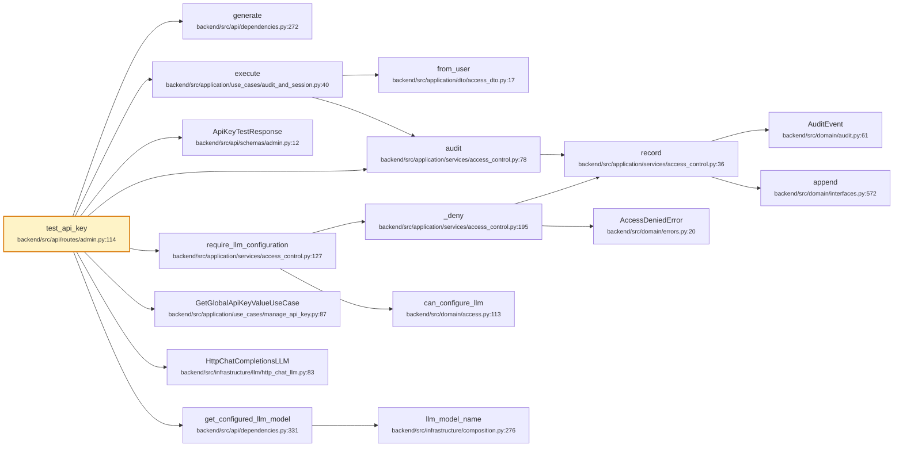

# `POST /api-key/test`

- **operationId**: `test_api_key`
- **tag**: routes
- **handler**: `backend/src/api/routes/admin.py::test_api_key`
- **call tree size**: 17 nodes, 18 edges
- **external calls**: 0 (top 15 below)

## Request
_No parameters._

## Responses
- **200**: OK

## Internal call tree

## Internal modules touched
| File | Symbols touched |
|------|------------------|
| `backend/src/application/services/access_control.py` | 4 |
| `backend/src/api/dependencies.py` | 2 |
| `backend/src/api/routes/admin.py` | 1 |
| `backend/src/api/schemas/admin.py` | 1 |
| `backend/src/application/dto/access_dto.py` | 1 |
| `backend/src/application/use_cases/audit_and_session.py` | 1 |
| `backend/src/application/use_cases/manage_api_key.py` | 1 |
| `backend/src/domain/access.py` | 1 |
| `backend/src/domain/audit.py` | 1 |
| `backend/src/domain/errors.py` | 1 |
| `backend/src/domain/interfaces.py` | 1 |
| `backend/src/infrastructure/composition.py` | 1 |
| `backend/src/infrastructure/llm/http_chat_llm.py` | 1 |

## External dependencies (top 15)
_None or all internal._

## Cross-endpoint reuse
Symbols this endpoint shares with other endpoints (top 20):

| Symbol | Also called from |
|--------|------------------|
| `AccessDeniedError` (`backend/src/domain/errors.py:20`) | `POST /{conversation_id}/chat/stream` |
| `_deny` (`backend/src/application/services/access_control.py:195`) | `POST /{conversation_id}/chat/stream` |
| `append` (`backend/src/domain/interfaces.py:572`) | `DELETE /{assistant_id}`, `DELETE /{conversation_id}`, `DELETE /{document_id}`, `GET /api-key/status`, `GET /audit-events`, `GET /feedback`, … (+24) |
| `AuditEvent` (`backend/src/domain/audit.py:61`) | `DELETE /{assistant_id}`, `DELETE /{conversation_id}`, `DELETE /{document_id}`, `GET /api-key/status`, `GET /audit-events`, `GET /feedback`, … (+24) |
| `audit` (`backend/src/application/services/access_control.py:78`) | `DELETE /{assistant_id}`, `DELETE /{conversation_id}`, `DELETE /{document_id}`, `GET /api-key/status`, `GET /audit-events`, `GET /feedback`, … (+24) |
| `record` (`backend/src/application/services/access_control.py:36`) | `DELETE /{assistant_id}`, `DELETE /{conversation_id}`, `DELETE /{document_id}`, `GET /api-key/status`, `GET /audit-events`, `GET /feedback`, … (+24) |
| `from_user` (`backend/src/application/dto/access_dto.py:17`) | `DELETE /{assistant_id}`, `DELETE /{conversation_id}`, `DELETE /{document_id}`, `GET /api-key/status`, `GET /audit-events`, `GET /feedback`, … (+23) |
| `execute` (`backend/src/application/use_cases/audit_and_session.py:40`) | `DELETE /{assistant_id}`, `DELETE /{conversation_id}`, `DELETE /{document_id}`, `GET /api-key/status`, `GET /audit-events`, `GET /feedback`, … (+23) |
