# `POST /{conversation_id}/messages`

- **operationId**: `add_message`
- **tag**: routes
- **handler**: `backend/src/api/routes/conversations.py::add_message`
- **call tree size**: 13 nodes, 12 edges
- **external calls**: 0 (top 15 below)

## Request
### Parameters
| Name | In | Required | Type | Description |
|------|-----|----------|------|-------------|
| `conversation_id` | path | True | string |  |

## Responses
- **200**: OK

## Internal call tree

```mermaid
flowchart LR
  backend_src_api_routes_conversations_py__message_response["_message_response<br/><small>backend/src/api/routes/conversations.py:439</small>"]
  backend_src_api_routes_conversations_py__not_found["_not_found<br/><small>backend/src/api/routes/conversations.py:92</small>"]
  backend_src_api_routes_conversations_py_add_message["add_message<br/><small>backend/src/api/routes/conversations.py:217</small>"]
  backend_src_api_schemas_conversations_py_CitationResponse["CitationResponse<br/><small>backend/src/api/schemas/conversations.py:42</small>"]
  backend_src_api_schemas_conversations_py_MessageResponse["MessageResponse<br/><small>backend/src/api/schemas/conversations.py:55</small>"]
  backend_src_application_dto_access_dto_py_CurrentUserDTO_from_user["from_user<br/><small>backend/src/application/dto/access_dto.py:17</small>"]
  backend_src_application_services_access_control_py_AccessControl_audit["audit<br/><small>backend/src/application/services/access_control.py:78</small>"]
  backend_src_application_services_access_control_py_AuditTrail_record["record<br/><small>backend/src/application/services/access_control.py:36</small>"]
  backend_src_application_use_cases_audit_and_session_py_DescribeCurrentUserUseCas["execute<br/><small>backend/src/application/use_cases/audit_and_session.py:40</small>"]
  backend_src_application_use_cases_manage_conversation_py_AddMessageInput["AddMessageInput<br/><small>backend/src/application/use_cases/manage_conversation.py:116</small>"]
  backend_src_application_use_cases_manage_conversation_py_AddMessageUseCase["AddMessageUseCase<br/><small>backend/src/application/use_cases/manage_conversation.py:123</small>"]
  backend_src_domain_audit_py_AuditEvent["AuditEvent<br/><small>backend/src/domain/audit.py:61</small>"]
  backend_src_domain_interfaces_py_AuditLogRepository_append["append<br/><small>backend/src/domain/interfaces.py:572</small>"]
  backend_src_api_routes_conversations_py__message_response --> backend_src_api_schemas_conversations_py_CitationResponse
  backend_src_api_routes_conversations_py__message_response --> backend_src_api_schemas_conversations_py_MessageResponse
  backend_src_api_routes_conversations_py_add_message --> backend_src_api_routes_conversations_py__message_response
  backend_src_api_routes_conversations_py_add_message --> backend_src_api_routes_conversations_py__not_found
  backend_src_api_routes_conversations_py_add_message --> backend_src_application_use_cases_audit_and_session_py_DescribeCurrentUserUseCas
  backend_src_api_routes_conversations_py_add_message --> backend_src_application_use_cases_manage_conversation_py_AddMessageInput
  backend_src_api_routes_conversations_py_add_message --> backend_src_application_use_cases_manage_conversation_py_AddMessageUseCase
  backend_src_application_services_access_control_py_AccessControl_audit --> backend_src_application_services_access_control_py_AuditTrail_record
  backend_src_application_services_access_control_py_AuditTrail_record --> backend_src_domain_audit_py_AuditEvent
  backend_src_application_services_access_control_py_AuditTrail_record --> backend_src_domain_interfaces_py_AuditLogRepository_append
  backend_src_application_use_cases_audit_and_session_py_DescribeCurrentUserUseCas --> backend_src_application_dto_access_dto_py_CurrentUserDTO_from_user
  backend_src_application_use_cases_audit_and_session_py_DescribeCurrentUserUseCas --> backend_src_application_services_access_control_py_AccessControl_audit
  backend_src_api_routes_conversations_py_add_message:::entry
classDef entry fill:#fef3c7,stroke:#d97706,stroke-width:2px
```

## Internal modules touched
| File | Symbols touched |
|------|------------------|
| `backend/src/api/routes/conversations.py` | 3 |
| `backend/src/api/schemas/conversations.py` | 2 |
| `backend/src/application/services/access_control.py` | 2 |
| `backend/src/application/use_cases/manage_conversation.py` | 2 |
| `backend/src/application/dto/access_dto.py` | 1 |
| `backend/src/application/use_cases/audit_and_session.py` | 1 |
| `backend/src/domain/audit.py` | 1 |
| `backend/src/domain/interfaces.py` | 1 |

## External dependencies (top 15)
_None or all internal._

## Cross-endpoint reuse
Symbols this endpoint shares with other endpoints (top 20):

| Symbol | Also called from |
|--------|------------------|
| `_message_response` (`backend/src/api/routes/conversations.py:439`) | `GET /{conversation_id}`, `POST /{conversation_id}/chat`, `POST /{conversation_id}/chat/stream` |
| `record` (`backend/src/application/services/access_control.py:36`) | `DELETE /{assistant_id}`, `DELETE /{conversation_id}`, `DELETE /{document_id}`, `GET /api-key/status`, `GET /audit-events`, `GET /feedback`, … (+24) |
| `append` (`backend/src/domain/interfaces.py:572`) | `DELETE /{assistant_id}`, `DELETE /{conversation_id}`, `DELETE /{document_id}`, `GET /api-key/status`, `GET /audit-events`, `GET /feedback`, … (+24) |
| `from_user` (`backend/src/application/dto/access_dto.py:17`) | `DELETE /{assistant_id}`, `DELETE /{conversation_id}`, `DELETE /{document_id}`, `GET /api-key/status`, `GET /audit-events`, `GET /feedback`, … (+23) |
| `MessageResponse` (`backend/src/api/schemas/conversations.py:55`) | `GET /{conversation_id}`, `POST /{conversation_id}/chat`, `POST /{conversation_id}/chat/stream` |
| `_not_found` (`backend/src/api/routes/conversations.py:92`) | `DELETE /{conversation_id}`, `GET /{conversation_id}`, `POST /{conversation_id}/chat`, `POST /{conversation_id}/chat/stream` |
| `CitationResponse` (`backend/src/api/schemas/conversations.py:42`) | `GET /{conversation_id}`, `POST /{conversation_id}/chat`, `POST /{conversation_id}/chat/stream` |
| `AuditEvent` (`backend/src/domain/audit.py:61`) | `DELETE /{assistant_id}`, `DELETE /{conversation_id}`, `DELETE /{document_id}`, `GET /api-key/status`, `GET /audit-events`, `GET /feedback`, … (+24) |
| `execute` (`backend/src/application/use_cases/audit_and_session.py:40`) | `DELETE /{assistant_id}`, `DELETE /{conversation_id}`, `DELETE /{document_id}`, `GET /api-key/status`, `GET /audit-events`, `GET /feedback`, … (+23) |
| `audit` (`backend/src/application/services/access_control.py:78`) | `DELETE /{assistant_id}`, `DELETE /{conversation_id}`, `DELETE /{document_id}`, `GET /api-key/status`, `GET /audit-events`, `GET /feedback`, … (+24) |
