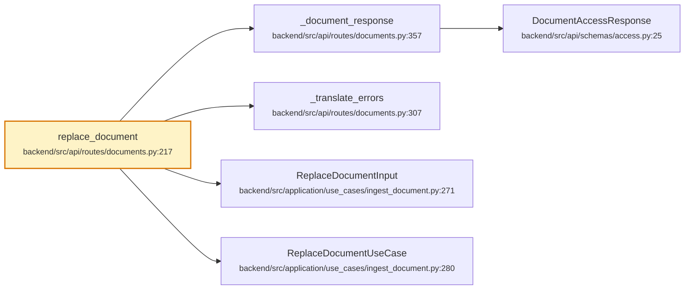

# `PUT /{document_id}/content`

- **operationId**: `replace_document`
- **tag**: routes
- **handler**: `backend/src/api/routes/documents.py::replace_document`
- **call tree size**: 6 nodes, 5 edges
- **external calls**: 0 (top 15 below)

## Request
### Parameters
| Name | In | Required | Type | Description |
|------|-----|----------|------|-------------|
| `document_id` | path | True | string |  |

## Responses
- **200**: OK

## Internal call tree

## Internal modules touched
| File | Symbols touched |
|------|------------------|
| `backend/src/api/routes/documents.py` | 3 |
| `backend/src/application/use_cases/ingest_document.py` | 2 |
| `backend/src/api/schemas/access.py` | 1 |

## External dependencies (top 15)
_None or all internal._

## Cross-endpoint reuse
Symbols this endpoint shares with other endpoints (top 20):

| Symbol | Also called from |
|--------|------------------|
| `DocumentAccessResponse` (`backend/src/api/schemas/access.py:25`) | `GET /{document_id}`, `POST /{document_id}/reprocess`, `PUT /{document_id}/groups` |
| `_document_response` (`backend/src/api/routes/documents.py:357`) | `GET /{document_id}`, `POST /{document_id}/reprocess`, `PUT /{document_id}/groups` |
| `_translate_errors` (`backend/src/api/routes/documents.py:307`) | `DELETE /{document_id}`, `GET /{document_id}`, `POST /{document_id}/reprocess`, `PUT /{document_id}/groups` |
