# `PUT /{document_id}/groups`

- **operationId**: `set_document_groups`
- **tag**: routes
- **handler**: `backend/src/api/routes/documents.py::set_document_groups`
- **call tree size**: 12 nodes, 11 edges
- **external calls**: 0 (top 15 below)

## Request
### Parameters
| Name | In | Required | Type | Description |
|------|-----|----------|------|-------------|
| `document_id` | path | True | string |  |

## Responses
- **200**: OK

## Internal call tree

```mermaid
flowchart LR
  backend_src_api_routes_documents_py__document_response["_document_response<br/><small>backend/src/api/routes/documents.py:357</small>"]
  backend_src_api_routes_documents_py__translate_errors["_translate_errors<br/><small>backend/src/api/routes/documents.py:307</small>"]
  backend_src_api_routes_documents_py_set_document_groups["set_document_groups<br/><small>backend/src/api/routes/documents.py:277</small>"]
  backend_src_api_schemas_access_py_DocumentAccessResponse["DocumentAccessResponse<br/><small>backend/src/api/schemas/access.py:25</small>"]
  backend_src_application_dto_access_dto_py_CurrentUserDTO_from_user["from_user<br/><small>backend/src/application/dto/access_dto.py:17</small>"]
  backend_src_application_services_access_control_py_AccessControl_audit["audit<br/><small>backend/src/application/services/access_control.py:78</small>"]
  backend_src_application_services_access_control_py_AuditTrail_record["record<br/><small>backend/src/application/services/access_control.py:36</small>"]
  backend_src_application_use_cases_audit_and_session_py_DescribeCurrentUserUseCas["execute<br/><small>backend/src/application/use_cases/audit_and_session.py:40</small>"]
  backend_src_application_use_cases_manage_assistant_access_py_SetDocumentGroupsIn["SetDocumentGroupsInput<br/><small>backend/src/application/use_cases/manage_assistant_access.py:151</small>"]
  backend_src_application_use_cases_manage_assistant_access_py_SetDocumentGroupsUs["SetDocumentGroupsUseCase<br/><small>backend/src/application/use_cases/manage_assistant_access.py:157</small>"]
  backend_src_domain_audit_py_AuditEvent["AuditEvent<br/><small>backend/src/domain/audit.py:61</small>"]
  backend_src_domain_interfaces_py_AuditLogRepository_append["append<br/><small>backend/src/domain/interfaces.py:572</small>"]
  backend_src_api_routes_documents_py__document_response --> backend_src_api_schemas_access_py_DocumentAccessResponse
  backend_src_api_routes_documents_py_set_document_groups --> backend_src_api_routes_documents_py__document_response
  backend_src_api_routes_documents_py_set_document_groups --> backend_src_api_routes_documents_py__translate_errors
  backend_src_api_routes_documents_py_set_document_groups --> backend_src_application_use_cases_audit_and_session_py_DescribeCurrentUserUseCas
  backend_src_api_routes_documents_py_set_document_groups --> backend_src_application_use_cases_manage_assistant_access_py_SetDocumentGroupsIn
  backend_src_api_routes_documents_py_set_document_groups --> backend_src_application_use_cases_manage_assistant_access_py_SetDocumentGroupsUs
  backend_src_application_services_access_control_py_AccessControl_audit --> backend_src_application_services_access_control_py_AuditTrail_record
  backend_src_application_services_access_control_py_AuditTrail_record --> backend_src_domain_audit_py_AuditEvent
  backend_src_application_services_access_control_py_AuditTrail_record --> backend_src_domain_interfaces_py_AuditLogRepository_append
  backend_src_application_use_cases_audit_and_session_py_DescribeCurrentUserUseCas --> backend_src_application_dto_access_dto_py_CurrentUserDTO_from_user
  backend_src_application_use_cases_audit_and_session_py_DescribeCurrentUserUseCas --> backend_src_application_services_access_control_py_AccessControl_audit
  backend_src_api_routes_documents_py_set_document_groups:::entry
classDef entry fill:#fef3c7,stroke:#d97706,stroke-width:2px
```

## Internal modules touched
| File | Symbols touched |
|------|------------------|
| `backend/src/api/routes/documents.py` | 3 |
| `backend/src/application/services/access_control.py` | 2 |
| `backend/src/application/use_cases/manage_assistant_access.py` | 2 |
| `backend/src/api/schemas/access.py` | 1 |
| `backend/src/application/dto/access_dto.py` | 1 |
| `backend/src/application/use_cases/audit_and_session.py` | 1 |
| `backend/src/domain/audit.py` | 1 |
| `backend/src/domain/interfaces.py` | 1 |

## External dependencies (top 15)
_None or all internal._

## Cross-endpoint reuse
Symbols this endpoint shares with other endpoints (top 20):

| Symbol | Also called from |
|--------|------------------|
| `DocumentAccessResponse` (`backend/src/api/schemas/access.py:25`) | `GET /{document_id}`, `POST /{document_id}/reprocess`, `PUT /{document_id}/content` |
| `record` (`backend/src/application/services/access_control.py:36`) | `DELETE /{assistant_id}`, `DELETE /{conversation_id}`, `DELETE /{document_id}`, `GET /api-key/status`, `GET /audit-events`, `GET /feedback`, … (+24) |
| `_document_response` (`backend/src/api/routes/documents.py:357`) | `GET /{document_id}`, `POST /{document_id}/reprocess`, `PUT /{document_id}/content` |
| `_translate_errors` (`backend/src/api/routes/documents.py:307`) | `DELETE /{document_id}`, `GET /{document_id}`, `POST /{document_id}/reprocess`, `PUT /{document_id}/content` |
| `append` (`backend/src/domain/interfaces.py:572`) | `DELETE /{assistant_id}`, `DELETE /{conversation_id}`, `DELETE /{document_id}`, `GET /api-key/status`, `GET /audit-events`, `GET /feedback`, … (+24) |
| `from_user` (`backend/src/application/dto/access_dto.py:17`) | `DELETE /{assistant_id}`, `DELETE /{conversation_id}`, `DELETE /{document_id}`, `GET /api-key/status`, `GET /audit-events`, `GET /feedback`, … (+23) |
| `AuditEvent` (`backend/src/domain/audit.py:61`) | `DELETE /{assistant_id}`, `DELETE /{conversation_id}`, `DELETE /{document_id}`, `GET /api-key/status`, `GET /audit-events`, `GET /feedback`, … (+24) |
| `execute` (`backend/src/application/use_cases/audit_and_session.py:40`) | `DELETE /{assistant_id}`, `DELETE /{conversation_id}`, `DELETE /{document_id}`, `GET /api-key/status`, `GET /audit-events`, `GET /feedback`, … (+23) |
| `audit` (`backend/src/application/services/access_control.py:78`) | `DELETE /{assistant_id}`, `DELETE /{conversation_id}`, `DELETE /{document_id}`, `GET /api-key/status`, `GET /audit-events`, `GET /feedback`, … (+24) |
