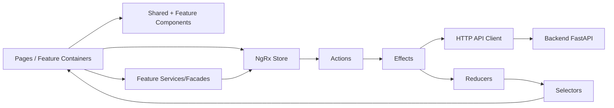
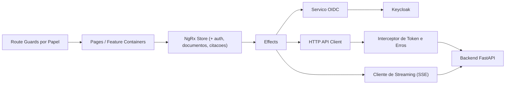

# C4 - Componentes do Frontend

## Objetivo

Descrever a organização do frontend Angular e o fluxo de estado via NgRx.

## Diagrama de Componentes do Frontend (C4 Nível 3)

## Responsabilidades

- **Pages / Feature Containers**: coordenam a tela e interações de usuário por feature.
- **Components**: apresentam UI reutilizável, com foco em composição e baixo acoplamento.
- **NgRx Store**: concentra estado previsível de assistente ativo, chat, documentos e erros.
- **Effects**: executam side effects assíncronos e integração HTTP com backend.
- **Reducers e Selectors**: transformam eventos em estado e oferecem leitura otimizada para UI.
- **API Client**: encapsula contratos HTTP para preservar consistência entre features.

## Evolução RAG Enterprise (Componentes Alvo)

Diagrama **planejado**; o diagrama acima continua representando o MVP.

### Novas Responsabilidades

- **Serviço OIDC**: login, logout e renovação silenciosa pelo Keycloak (PKCE).
- **Interceptor**: anexa o token e trata respostas 401, 403 e 429.
- **Route Guards**: bloqueiam rotas conforme o papel e redirecionam para o login.
- **Store**: novo estado de sessão; documentos com estado de ingestão; mensagens com citações e feedback.
- **Cliente de Streaming**: recebe a resposta em partes e as fontes ao final.
- **Novas telas**: permissões do assistente, gestão de documentos, índice de busca, auditoria,
  consumo, avaliações e conversas arquivadas.
- **Configuração de LLM (SPEC-013)**: a tela "Chaves de LLM" (`/admin/llm-credentials`) e as
  seções "Modelo de linguagem" e "Recuperação" da página de assistentes usam a fatia
  `llmConfig` do store (actions, reducer, effects e selectors próprios); as regras de tela
  (faixas, conflitos 409, preços) ficam em funções puras em `shared/llm`.
- **Acesso rápido da tela inicial (SPEC-016)**: a tela inicial mostra os assistentes escolhidos
  pelo usuário, padrão primeiro e com o selo "Padrão". O modal "Personalizar acesso rápido"
  (`features/home/home-assistants-dialog.component.ts`) só apresenta e emite a escolha; as regras
  (limite, padrão automático, contador, cartões efetivos) ficam em `shared/home`. A fatia
  `nexus` guarda `homeAssistants` e o estado do modal; a action `applyDefaultAssistant` torna o
  padrão ativo ao carregar e em "Nova conversa", sem passar pela navegação para o chat.
- **Edição do assistente (SPEC-017)**: o card "Dados do assistente"
  (`features/assistants/assistant-profile-settings.component.ts`) fica no topo da página de
  assistentes, para o administrador e o curador do assistente; ele só apresenta e despacha
  `updateAssistant`. As regras (limites 80/500/4000, campo vazio vira `null`, aviso de nome
  repetido, visibilidade do card, mensagens por `code`) ficam em `shared/assistants`. O
  `NexusApiService.updateAssistant` chama `PUT /assistants/{id}`; o modal de criação usa os mesmos
  limites e mensagens.
