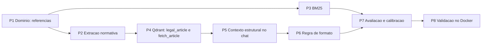

# Plano de Implementação — SPEC-012 Dispositivos normativos e formato da resposta

**Spec**: [SPEC-20261026-012](SPEC-012-dispositivos-normativos-e-formato-de-resposta.md) (Aprovada em 2026-10-26)
**Status do plano**: Concluído em 2026-10-27 — P1 a P8 entregues e validados; D11 a D13 ficam para continuação
**Data**: 2026-10-26
**Elaborado com apoio de IA generativa, pendente de revisão do autor**

## 0. Andamento

| Pacote | Situação em 2026-10-26 | Verificado por |
|--------|------------------------|----------------|
| P0 Decisões | Escolhidas pelo autor em 2026-10-26 (D9 alterada para 0,30 e revista em 2026-10-27 para 0,10) | Registro na SPEC |
| P1 Domínio | Entregue: `domain/legal_references.py` (títulos normativos, referência na pergunta, item no trecho, intervalo omitido), `legal_article` em `VectorChunk`, `chunk_index` em `SearchResult`, porta `fetch_article` | `test_legal_references` (26) |
| P2 Extração | Entregue: modo normativo em PDF, DOCX, TXT e DOC (limiar 5); subtítulo da linha seguinte entra no título ("TÍTULO II - DOS DIREITOS..."); cada inciso, parágrafo e alínea abre bloco; `PIPELINE_VERSION` = 4 | `test_normative_extraction` (11) |
| P3 BM25 | Entregue: ordinais, `artigo`→`art`, `§`/`parágrafo`→`par` | `test_bm25_normalization` (7) |
| P4 Qdrant | Entregue: payload e índice `legal_article`, `fetch_article` por `scroll` com os filtros da busca, span próprio | `test_article_fetch` (CT-96) no Docker, 2026-10-27: 3 testes OK |
| P5 Contexto estrutural | Entregue: `ContextRetriever.structural_context` (D6, D7), `fit_structural_context` (D8), nó `structural_context` no grafo (com e sem streaming), log `chat.context.structural`, auditoria só com o que foi enviado, avaliação no mesmo caminho, `STRUCTURAL_CONTEXT_TOKEN_BUDGET` | `test_structural_context` (24) |
| P6 Formato | Entregue: `FORMAT_INSTRUCTION` global e aviso de omissão por último | `test_structural_context` (CT-95) |
| P7 Avaliação | Entregue: `fixtures/normativo/` (regulamento e estatuto fictícios, `.txt`), `normativo-ficticio.jsonl` (15 rascunhos sem `validated_by`), seed aceita `.txt`, scripts `eval` e `calibrate`, `.env.example` com `RELEVANCE_MIN_SCORE=0.10` (D9 revista em 2026-10-27; 0,30 foi medido e tirou respostas) | Simulação em memória: as 12 perguntas com dispositivo caem no documento e no artigo certos; a recalibração fica para o Docker |
| P8 Validação no Docker | Em andamento (2026-10-27): testes unitários no container; diagnóstico mostrou documentos ainda na versão 3 (faltava reindexar) e a Constituição reconhecida como norma (276 linhas de artigo); após reindexar, "Explique o artigo 5 da constituição" leu o artigo inteiro (50 trechos, nada omitido) e "inciso XI do art. 5º" leu caput e inciso. Achados corrigidos: "Art. 2 o" com espaço antes do ordinal; tempo limite de 30 s estourado na resposta do artigo inteiro (D14, `LLM_TIMEOUT_SECONDS=120`). **CT-98 aprovado pelo autor para o Art. 5º.** **CT-96 aprovado** (3 testes de integração com o Qdrant real, 2026-10-27). CT-97 parcial (2026-10-27): `nexus-docs-ampliado` com recuperação igual à linha de base (recall@5 0,984, MRR 0,901) e queda nas respostas causada pela nota 0,30 (D9 revista para 0,10); `nexus-docs` com recall 1,0. Com 0,10 (11:41–11:49): `nexus-docs-ampliado` com citação 0,952 (acima da linha de base 0,935) e fidelidade 0,932 (era 1,0); `nexus-docs` sem regressão; `normativo-ficticio` com recall e MRR 1,0, mas fidelidade 0,5: as respostas em lista acrescentavam interpretação no "resumo explicativo". `FORMAT_INSTRUCTION` reescrita para o resumo só sintetizar os trechos, com citações. Com a regra nova (11:58–12:12): `normativo-ficticio` recall 1,0, MRR 1,0, fidelidade 0,917, citação 1,0; `nexus-docs-ampliado` recall 0,984, MRR 0,901, fidelidade 1,0, citação 0,952, sem regressão. **CT-97 aprovado.** Curadoria (2026-10-27): 16 itens validados por Cleiton Medeiros (`nor-fora-04` acrescentado a pedido do curador). Linha de base oficial do `normativo-ficticio` (11:17, validada): recall 1,0, MRR 1,0, fidelidade 0,833, recusa 0,75. A resposta do Art. 7º trocou "quadro social" da associação por "clube" no resumo: `FORMAT_INSTRUCTION` passa a exigir os termos do próprio texto. Com essa regra (14:57 UTC): recall 1,0, MRR 1,0, fidelidade 0,917, citação 1,0, recusa 0,75, sem regressão. **P8 concluído.** Pendentes para SPEC de continuação: D11 a D13 | Autor |

Verificação feita fora do Docker, em Python 3.13 com o LangGraph substituído por um dublê:
**774 testes unitários passam** (705 anteriores e 69 novos). `ruff` não pôde ser instalado (sem
acesso ao PyPI); uma verificação equivalente às regras F (imports sem uso) não achou problemas.
**Não verificado**: adaptador do Qdrant (`fetch_article`, índice), extração de PDF real, modelos
reais de embedding e reranking, LLM e a tela.

## 1. Ordem de execução

Fluxo `/spec-to-code`: testes antes do código em cada pacote; P1 a P3 podem ser entregues e
medidos antes de P4 a P6, porque sozinhos já fazem a pergunta por artigo achar o trecho certo.

## 2. Pacotes

| Pacote | O que muda | Arquivos principais | Testes |
|--------|------------|---------------------|--------|
| **P1 Domínio** | Funções puras: reconhecer o título de um dispositivo numa linha (`TÍTULO`, `CAPÍTULO`, `Seção`, `Subseção`, `Art. N[º/o/-A]`); extrair referências da pergunta (artigo, inciso em romano, parágrafo, parágrafo único); normalizar ordinal (`5º` → `5`). `legal_article` em `VectorChunk` e `SearchResult`. Porta `fetch_article` em `VectorStoreGateway`. | `domain/legal_references.py` (novo), `domain/entities.py`, `domain/value_objects.py`, `domain/interfaces.py` | CT-91 (parte), CT-93 |
| **P2 Extração** | Modo normativo por documento (limiar da D3) em PDF, DOCX e texto; níveis da D4 no `_SectionStack`. O chunker não muda: o prefixo já vem do `section_path` e `_prefix` já descarta os níveis externos. O indexador deriva `legal_article` do último nível `Art.` do caminho. `PIPELINE_VERSION` → `4`. | `infrastructure/documents/structured_extraction.py`, `application/services/document_indexing.py` | CT-91 |
| **P3 BM25** | `tokenize` com a normalização da D5, aplicada antes do `_fold` para não perder o `º`. Mesma função na indexação e na pergunta. | `infrastructure/embeddings/bm25_sparse_embedding.py` | CT-92 |
| **P4 Qdrant** | `legal_article` no payload; índice `keyword` criado em `ensure_collection` (e em `_ensure_lifecycle_indexes` para coleções existentes); `fetch_article` com `scroll` filtrado por artigo, `user_groups` e `active`, ordenado por documento e `chunk_index`. | `infrastructure/vector_store/qdrant_store.py` | CT-96 (integração) |
| **P5 Contexto estrutural** | `ContextRetriever.structural_context(...)`: referência da pergunta → `fetch_article` → escolha do documento (D7) → rerank interno quando a pergunta cita inciso ou parágrafo (D6). `fit_context` recebe o orçamento e devolve os trechos omitidos (D8). Novo nó `structural_context` no grafo do chat, entre `retrieve_context` e `evaluate_context`, nos dois modos (com e sem streaming); log `chat.context.structural`. `STRUCTURAL_CONTEXT_TOKEN_BUDGET` em `RetrievalSettings` e `composition.py`. A avaliação usa o mesmo serviço. | `application/services/retrieval.py`, `application/services/grounded_answer.py`, `application/use_cases/chat_with_assistant.py`, `application/use_cases/evaluate_assistant.py`, `infrastructure/composition.py`, `.env.example` | CT-94 |
| **P6 Formato** | `FORMAT_INSTRUCTION` (D1) somada a `CITATION_INSTRUCTION` em `build_answer_instruction` (D2). Quando o contexto estrutural omitiu trechos, a instrução recebe o intervalo omitido para a resposta informar (RN-36). | `application/services/grounded_answer.py` | CT-95 |
| **P7 Avaliação** | Regulamento fictício (Markdown ou texto, com títulos, capítulos e cerca de 15 artigos, um deles com 20 incisos) e o conjunto `normativo-ficticio.jsonl`. `.env.example` com `RELEVANCE_MIN_SCORE=0.10` (D9 revista em 2026-10-27; 0,30 foi medido e tirou respostas). Recalibração planejada (`calibrate_relevance`) com os três conjuntos, medindo também a taxa de fallback; o valor final é do operador. | `backend/tests/evaluation/datasets/`, `backend/tests/evaluation/corpus/` | CT-97 |
| **P8 Validação** | Docker: rebuild, reindexação dos assistentes, CT-96, portão de qualidade com os três conjuntos e CT-98 com a Constituição do autor. Revisão do `rag-quality-reviewer` e do `architecture-guard`. | — | CT-96 a CT-98 |

## 3. Esboço da regra de formato (D1, opção a)

Texto inicial para revisão; o final entra no CT-95.

> Seja sucinto: responda primeiro ao que foi perguntado, em poucos parágrafos, sem repetir o texto
> dos trechos. Quando o conteúdo pedido for enumerado (incisos, alíneas, itens, requisitos,
> etapas), liste **todos** os itens na ordem original, um por linha, com o identificador do item
> (por exemplo "I –", "a)", "§ 1º") e uma frase curta que o resuma, cada um com sua citação. Depois
> da lista, escreva um resumo explicativo de até cinco frases. Se o contexto avisar que parte do
> conteúdo ficou de fora, diga quais itens não foram incluídos.

## 4. Como validar no Docker (P8)

1. No `.env` (feito pelo autor): incluir `STRUCTURAL_CONTEXT_TOKEN_BUDGET=16000` `LLM_TIMEOUT_SECONDS=120` (D14) e manter `RELEVANCE_MIN_SCORE=0.10` (D9 revista).
2. `docker compose up -d --build`.
3. Reindexar cada assistente pela tela de administração (ou pelo fluxo de reindexação); conferir
   no estado do índice a versão de pipeline `4`.
4. No assistente jurídico: "Explique o artigo 5 da constituição". Esperado: log
   `chat.context.structural` com `article: 5`, e a resposta com os incisos I a LXXVIII, os
   parágrafos e o resumo.
5. "O que diz o inciso XI do art. 5º?": resposta curta citando o inciso XI.
6. Uma pergunta conceitual sem número de artigo continua passando pela busca híbrida.
7. `scripts/quality-gate.sh nexus-docs`, `nexus-docs-ampliado` e `normativo-ficticio`, sem
   regressão.
8. Recalibrar a nota mínima com o `calibrate_relevance` (D9) e registrar na SPEC o valor escolhido e a taxa de fallback medida.

## 5. Estimativa

| Pacote | Esforço |
|--------|---------|
| P1 a P3 | Pequeno a médio: funções puras, testes rápidos |
| P4 | Pequeno, mas só verificável no Docker |
| P5 | Médio: o grafo do chat tem dois modos e a avaliação também precisa do caminho |
| P6 | Pequeno |
| P7 | Médio: escrever o regulamento e as perguntas com os trechos esperados |
| P8 | Depende do ambiente; a reindexação da Constituição leva poucos minutos |
