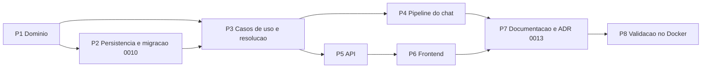

# Plano de Implementação — SPEC-013 Várias chaves de LLM, modelo e parâmetros por assistente

**Spec**: [SPEC-20261027-013](SPEC-013-chaves-de-llm-e-parametros-por-assistente.md) (Aprovada em 2026-10-27)
**Status do plano**: Concluído em 2026-10-28 — P1 a P8 entregues; CT-112 adiado pelo autor ([validação](../../qa/relatorios/2026-10-28-spec-013/LEIAME.md))
**Data**: 2026-10-27
**Elaborado com apoio de IA generativa, pendente de revisão do autor**

## 0. Andamento

| Pacote | Situação em 2026-10-27 | Verificado por |
|--------|------------------------|----------------|
| P0 Decisões | D1 a D10 escolhidas pelo autor em 2026-10-27 (todas as recomendações); D11 (revisão do P1), D12 (revisão do P2/P3) e D13 (revisão do P5) acrescentadas no mesmo dia | Registro na SPEC |
| P1 Domínio | Entregue: `LLMCredentialId` em `domain/value_objects.py`; `domain/llm_credentials.py` (`LLMModelOption`, `LLMCredential`, regras RN-37/RN-38, recuo da D11), `domain/retrieval_profile.py` (`RetrievalProfile`, `RetrievalDefaults`, `ResolvedRetrievalProfile`, `ParameterOrigin`), `Assistant` com credencial, modelo e perfil, porta `LLMCredentialRepository`, erro `LLMCredentialInUseError`, ações de auditoria novas | `test_llm_credentials` (42), `test_retrieval_profile` (15) |
| P2 Persistência | Entregue: migração `0010_llm_credentials` (tabela, nome único sem diferenciar maiúsculas, índice único parcial da padrão, FK `RESTRICT`, colunas no assistente, cópia da chave e do `llm_connection` para a credencial "Padrão" e volta no `downgrade`; as linhas antigas ficam até o P5, T9), `LLMCredentialModel`, `PostgresLLMCredentialRepository` (troca da padrão em duas instruções na mesma transação, com a linha travada; a padrão nunca sai pelo próprio `DELETE`; violação de índice ou FK vira erro de domínio, nunca 500), assistente com `update_llm_choice` e `update_retrieval_profile` (sem atualização perdida); conversão JSON em `infrastructure/llm_credential_mapping.py`, fora do pacote `database` para ser testada sem SQLAlchemy | `test_llm_credential_mapping` (9); CT-107 escrito em `tests/integration/test_llm_credentials_storage.py` (6 testes, inclusive as corridas que o banco fecha), a rodar no Docker |
| P3 Aplicação | Entregue: `manage_llm_credentials.py` (listar, opções para o assistente, criar, alterar com rotação e chave nova obrigatória quando o destino muda (D12), excluir, marcar padrão, impacto da troca da padrão para a D11, testar), `configure_assistant.py` (LLM e recuperação do assistente, com valor efetivo e origem), `services/llm_resolution.py` (RN-40, RN-41, D8, D11; chave decifrada só aqui), porta `SecretCipher` movida para o domínio. Os casos de uso da SPEC-008 saem junto com as rotas, no P5, para a API continuar importável até lá | `test_llm_credential_use_cases` (47) |
| P4 Pipeline do chat | Entregue: `services/assistant_runtime.py` (`AssistantRuntime`, `build_assistant_runtime`, `assistant_retrieval_settings`) monta, a cada pergunta, o LLM resolvido e os parâmetros do assistente; `ChatWithAssistantUseCase` recebe `runtime_resolver` (com e sem streaming), troca o recuperador e o gerador da pergunta e registra `chat.runtime.resolved` sem a chave; `RetrievalSettings.hybrid_enabled` e `ContextRetriever.with_settings`: híbrida desligada manda o vetor esparso vazio e o adaptador do Qdrant já faz só a pré-busca densa, com os mesmos filtros (sem mudança no Qdrant); consumo com modelo e preço do assistente (D8); `get_assistant_runtime_resolver` e `get_llm_gateway_builder` nas rotas do chat; `evaluate` e `calibrate_relevance` usam o mesmo caminho e o relatório registra fonte, credencial, recuo e híbrida (RF-95). Testes de integração que trocavam o LLM passam a trocar `get_llm_gateway_builder`. Os testes de pilha real e o `leakage_scan` ainda configuram o LLM pelas rotas da SPEC-008: migram no P5 | `test_assistant_runtime` (13); CT-108 pendente no Docker |
| P5 API | Entregue: `routes/llm_credentials.py` (`/admin/llm-credentials`: listar com presets e moeda, criar, alterar, excluir, padrão, impacto da D11, testar; `/llm-credentials/options`), `routes/assistant_settings.py` (`/assistants/{id}/llm` e `/retrieval-settings`, com as faixas da D6), 409 com `code` `llm_credential_in_use` (assistentes, modelos, se é a padrão) e `concurrent_change` em `api/errors.py`; `/assistants/infer` usa a credencial padrão (`resolve_default_llm`). D9: saem `/admin/api-key*`, `/admin/llm-settings`, `manage_api_key.py`, `manage_llm_connection.py`, `PostgresLLMConnectionRepository`, `PostgresSecretSettingsRepository` e as portas `LLMConnectionRepository`/`SecretSettingsRepository` (as tabelas ficam); migração `0011` apaga a chave global e o `llm_connection` (T9), com `downgrade` a partir da padrão. Testes de pilha (`stack_support.use_fake_llm`, `test_full_stack_flow`, `test_assistant_isolation`, `test_ocr_container`, `test_keycloak_real`) e o `leakage_scan` (CT-56) usam uma credencial temporária só nos assistentes do teste, sem mexer na padrão (pulam ou param se a pilha não tem credencial); o CT-56 passa a falhar se o LLM simulado não for chamado num controle permitido | CT-109 em `test_access_control_api.py` (`LLMCredentialsApiTestCase`, 8 testes, e os de papéis do CT-30 reescritos); CT-107 ajustado para a `0011`; integração a rodar no Docker |
| P6 Frontend | Entregue: slice NgRx `llmConfig` (actions, reducer, seletores, effects; recarrega a lista depois de toda alteração; 409 da RN-38 vira conflito com nomes dos assistentes); página `/admin/llm-credentials` (lista com padrão, chave configurada, modelos e preços, quem usa e quem segue; criar e editar com modelos e preços, chave obrigatória ao criar e ao trocar o destino (D12); tornar padrão com confirmação que mostra quem segue e quem recua (D11); excluir; testar com o modelo escolhido); seções "Modelo de linguagem" (administrador edita, curador vê) e "Recuperação" (administrador e curador, com valor efetivo, origem, faixas da D6, aviso dos filtros fixos, de recalibração e de linha de base, restaurar padrão) na página de assistentes; item "Chaves de LLM" no menu Administração; sai o modal da SPEC-008, suas actions, estado, effects, seletores e o efeito de sessão que pedia a situação da chave; E2E do menu atualizado | `shared/llm/llm-config.spec.ts` (11, executado aqui com um substituto do Vitest), `llm-config.reducer.spec.ts` (6) e `llm-config.effects.spec.ts` (4) para o `npm test`; sintaxe de todos os `.ts` conferida com o TypeScript 6 |
| P7 Documentação | Entregue: diagramas C4 e páginas de arquitetura (2026-10-28), ADR 0013 (a 0012 já era o tema do Keycloak), status das ADRs 0005 e 0007, CT-99 a CT-112 na estratégia de testes (CT-64 a CT-66, CT-68 e CT-69 marcados como removidos), `variaveis-ambiente.md`, tabela de rotas da SPEC-004 e a skill `desenvolvedor-nexus`. SPEC-008 marcada como substituída | Revisão do autor |
| P8 Validação no Docker | Entregue em 2026-10-28 sobre `79227cb`: migrações `0010`/`0011` na subida com a chave "Padrão" e o chat funcionando, `npm test` e `npm run build` (autor); 159 testes de integração sem pulos (CT-107, CT-108, CT-109); CT-56 sem vazamento; E2E 17/17 (depois de `workers: 1`: logins simultâneos do mesmo usuário esbarravam na proteção contra força bruta do realm); CT-111 sem regressão de recuperação nos três conjuntos (a queda de fidelidade de 1,000 para 0,947 no `nexus-docs` é variação do juiz, acima da linha de base de 0,895). CT-112 adiado pelo autor | [validação](../../qa/relatorios/2026-10-28-spec-013/LEIAME.md) |

Verificação feita fora do Docker, em Python 3.13 com o LangGraph substituído por um dublê:
**901 testes unitários passam** (778 anteriores, 134 novos e 11 removidos com os casos de uso da SPEC-008). `ruff` não pôde ser instalado (sem
acesso ao PyPI); uma verificação equivalente à regra F401 (imports sem uso) não achou problemas.
Revisões do `architecture-guard`: P1 e P2/P3 sem bloqueantes; os achados importantes foram
corrigidos (P1: T3, T6, T7 e D11; P2/P3: T9, atualização perdida, corridas traduzidas, chave fora
do `repr` das entradas, 403 antes de 404, nome único sem diferenciar maiúsculas).
Revisão do `architecture-guard` no P5: sem bloqueantes; corrigidos o 422 que devolvia o corpo com a chave, a decifragem que falhava virando 502 no teste da credencial (agora 503 com código próprio), a limpeza do CT-56 e do `stack_support`, a `0011` idempotente, códigos próprios de erro e a montagem dos gateways em `composition.py`. `/assistants/infer` segue na credencial padrão com o catálogo completo (D13, decisão do autor).
Revisão do `rag-quality-reviewer` no P4: sem bloqueantes; corrigidos I1 (chave que não decifra vira
"sem chave", com log de erro, em vez de 422), I2 (P5 e `leakage_scan`), I3 (relatório de avaliação com
`judge_model`, origem de cada parâmetro, `top_k` limitado e aviso `baseline_comparable` quando a
configuração muda; calibração com assistente e parâmetros, `--assistant`), I4 (quatro testes do
revisor no repositório) e os menores M1, M2, M3, M6 e M7.
**Não verificado**: nada roda aqui com FastAPI, SQLAlchemy, PostgreSQL ou Qdrant: migrações e
repositórios (CT-107), rotas (CT-109), busca só densa (CT-108) e os testes de pilha ficam para o
Docker. Frontend: sem `npm` aqui, nem build nem `npm test` rodaram; os specs do reducer e dos effects e a checagem de tipos dos templates (`strictTemplates`) ficam para o P8.

## 1. Ordem de execução

Fluxo `/spec-to-code`: testes antes do código em cada pacote. P1 a P4 mantêm o comportamento atual
quando nada está gravado (o objetivo de não regressão da SPEC), então podem ser entregues e
medidos antes da API e da tela.

## 2. Pacotes

| Pacote | O que muda | Arquivos principais | Testes |
|--------|------------|---------------------|--------|
| **P1 Domínio** | `LLMCredential` com nome (até 100 caracteres), provedor, URL (regras da SPEC-008 D3 reaproveitadas de `llm_settings.py`), modelos sem duplicata, modelo padrão dentro da lista, padrão do sistema e chave configurada; `LLMModelOption` com preço opcional (entrada e saída juntos, não negativos, D8); `connection_for(model)` devolve a `LLMConnection` que o cliente HTTP já usa. Regras puras: `ensure_removable` (RN-38: padrão ou em uso por assistente → `LLMCredentialInUseError`), `ensure_models_removable` (modelo em uso), `default_after_change` (RN-37). `RetrievalProfile` com campos opcionais e faixas da D6; `validate_against(defaults)` recusa, ao gravar, top_k acima dos candidatos efetivos (T3); `resolve(defaults)` devolve valores efetivos e origem por campo e nunca falha na pergunta (top_k limitado aos candidatos, com `top_k_clamped`). `Assistant` ganha `llm_credential_id`, `llm_model` (com recuo da D11 quando segue a padrão) e `retrieval_profile`; `model_with_fallback` e `assistants_falling_back` (D11). Porta `LLMCredentialRepository`. Ações de auditoria da RF-94; as antigas (`llm_api_key.*`, `llm_settings.changed`) continuam no enum para a trilha já gravada. | `domain/llm_credentials.py`, `domain/retrieval_profile.py` (novos), `domain/entities.py`, `domain/interfaces.py`, `domain/errors.py`, `domain/audit.py`, `domain/__init__.py` | CT-99, CT-100, CT-101 e CT-102 (parte de domínio) |
| **P2 Persistência** | Migração `0010` (`/new-migration`): tabela `llm_credentials` (id, nome único, provedor, URL, modelos em JSON, modelo padrão, `is_default` com índice único parcial, ciphertext, autoria e datas); em `assistants`, `llm_credential_id` (FK `ON DELETE RESTRICT`), `llm_model` e `retrieval_profile` (JSON). Dados: cópia de `global_llm_api_key` e `llm_connection` para a credencial "Padrão" (D10), sem decifrar; `downgrade` devolve a padrão ao `app_settings`. `PostgresLLMCredentialRepository` (troca da padrão numa transação) e mapeamento das colunas novas em `PostgresAssistantRepository`. | `infrastructure/database/alembic/versions/0010_llm_credentials.py`, `infrastructure/database/models.py`, `infrastructure/database/repositories.py`, `infrastructure/database/operations_repositories.py` | CT-107 (integração) |
| **P3 Aplicação** | Casos de uso: listar, criar, alterar (com rotação opcional da chave), excluir, marcar padrão e testar credencial (só administrador, D7); `UpdateAssistantLLMUseCase` (administrador; modelo precisa estar na credencial); `UpdateAssistantRetrievalSettingsUseCase` e consulta com origem (administrador e curador do assistente). `resolve_llm_for_assistant` (RN-40) e `resolve_retrieval_settings` (RN-41) substituem `resolve_llm_connection` e o `retrieval_settings()` único. Auditoria sem a chave (RN-39). Saem os casos de uso da SPEC-008 (D9). | `application/use_cases/manage_llm_credentials.py`, `application/use_cases/configure_assistant.py` (novos), `application/services/llm_resolution.py` (novo), `application/services/access_control.py` | CT-101 a CT-105 |
| **P4 Pipeline do chat** | `chat_with_assistant` (com e sem streaming) recebe a conexão, a chave decifrada em memória, o preço do modelo e os parâmetros resolvidos por pergunta. `ContextRetriever` usa `candidates`, `top_n` e `min_score` do perfil; `RetrievalSettings.hybrid_enabled` (desligado = vetor esparso vazio; o adaptador do Qdrant faz só a pré-busca densa, mesmos filtros de `user_groups` e `active`). `HttpChatCompletionsLLM` criado por credencial. Consumo usa o preço do modelo ou `LLM_PRICE_*`. `evaluate` e `calibrate_relevance --assistant` usam a mesma resolução e registram credencial, modelo e parâmetros (RF-95). | `application/use_cases/chat_with_assistant.py`, `application/services/retrieval.py`, `infrastructure/vector_store/qdrant_store.py`, `api/dependencies.py`, `infrastructure/composition.py`, `cli/evaluate.py`, `cli/calibrate_relevance.py` | CT-106, CT-108 (integração), CT-111 (avaliação) |
| **P5 API** | `/admin/llm-credentials` (`GET`, `POST`), `/{id}` (`PUT`, `DELETE`), `/{id}/default` e `/{id}/test` (`POST`); `GET /llm-credentials/options`; `GET/PUT /assistants/{id}/llm` e `/assistants/{id}/retrieval-settings`. `LLMCredentialInUseError` → 409 com os assistentes afetados; códigos novos em `api/error_codes.py`. Saem `/admin/llm-settings` e `/admin/api-key*` (D9). | `api/routes/llm_credentials.py` (novo), `api/routes/assistants.py`, `api/routes/admin.py`, `api/schemas/` | CT-109 (integração) |
| **P6 Frontend** | Página `/admin/llm-credentials` no `administrationMenu` (lista, padrão com a lista de assistentes afetados antes de confirmar, criar, editar, rotacionar chave, testar, excluir, preço por modelo com aviso quando ausente). Seções "Modelo de linguagem" e "Recuperação" no assistente, com valor efetivo, origem, "restaurar padrão", aviso fixo dos filtros de segurança, de recalibração e de linha de base. Sai o formulário da SPEC-008. | `pages/llm-credentials-page.component.*` (novo), `pages/assistants-page.component.*`, `store/`, `core/services/nexus-api.service.ts`, `shared/models/nexus.models.ts` | CT-110 |
| **P7 Documentação** | ADR 0013 e status da ADR 0005 (substituída em parte) e 0007 (complementada); `estrategia-de-testes.md` com CT-99 a CT-112; `variaveis-ambiente.md` dizendo que `RETRIEVAL_CANDIDATES`, `RERANK_TOP_N`, `RELEVANCE_MIN_SCORE`, `LLM_MODEL` e `LLM_API_URL` viram padrão global; C4 de componentes; skill `desenvolvedor-nexus` (item 7 e ADRs vigentes). | `docs/arquitetura/adrs/`, `docs/especificacao/`, `docs/infraestrutura/`, `.claude/skills/desenvolvedor-nexus/SKILL.md` | — |
| **P8 Validação** | Docker: rebuild, migração `0010` sobre um banco com chave gravada (credencial "Padrão" criada, chat igual), CT-107 a CT-109, portão de qualidade nos três conjuntos sem configuração gravada (CT-111), CT-112 com OpenAI e Gemini reais em dois assistentes. Revisão do `architecture-guard` e do `rag-quality-reviewer`. | — | CT-107 a CT-112 |

## 3. Decisões técnicas deste plano

Escolhas de implementação que não mudam comportamento visível; ficam aqui para a revisão do autor.

| # | Escolha | Motivo |
|---|---------|--------|
| T1 | O preço do modelo guarda entrada e saída juntos ou nenhum dos dois; a moeda continua a de `LLM_PRICE_CURRENCY`. | Um preço só de entrada daria custo parcial sem aviso. |
| T2 | Substituída pela D11 da SPEC (autor, 2026-10-27): o assistente que segue a padrão pode guardar modelo, com recuo. | A revisão de arquitetura mostrou que a restrição mudava comportamento visível; virou decisão do autor. |
| T3 | A regra top_k ≤ candidatos vale sobre os valores efetivos (assistente ou padrão), conferida ao gravar. Na pergunta nunca há erro: se o ambiente mudou depois, top_k é limitado aos candidatos e o chat registra. | Um top_k gravado de 20 com candidatos do ambiente em 10 seria aceito campo a campo; recusar na pergunta derrubaria o chat do assistente. |
| T4 | Os valores do ambiente não passam pelas faixas da D6. | Hoje funcionam; recusar na subida mudaria o comportamento sem configuração gravada. |
| T5 | As ações de auditoria antigas ficam no enum. | A trilha já gravada continua legível na tela de auditoria. |
| T6 | `LLMCredential` recusa, em qualquer construção, URL com usuário/senha, parâmetros ou fragmento, e preset com URL diferente da do provedor. | RN-39: o repositório e a migração `0010` constroem sem passar por `build`; uma chave na URL vazaria na API e na auditoria. |
| T7 | Ao recusar a remoção da credencial padrão, o 409 lista também os assistentes que a seguem sem escolha. | A tela mostra quem seria afetado (risco da SPEC). |
| T8 | O curador do assistente consulta a credencial e o modelo efetivos (sem a chave); só o administrador altera. | A D7 restringe a escolha; a seção "Modelo de linguagem" (RF-92) aparece na tela que o curador já usa. |
| T9 | A `0010` só copia a chave e o `llm_connection`; as linhas antigas saem numa migração própria no P5, junto com as rotas da SPEC-008 (D9). A `0010` foi ajustada antes de ser aplicada em qualquer banco (só existe neste branch). | Até o P4 o chat ainda lê o caminho antigo; apagar antes deixaria o chat sem chave. |
| T10 | A migração lê `LLM_API_URL` e `LLM_MODEL` quando não há `llm_connection` gravado: o container que roda o Alembic (a API, na subida) precisa do mesmo ambiente. | D10. Registrar no P7/P8. |
