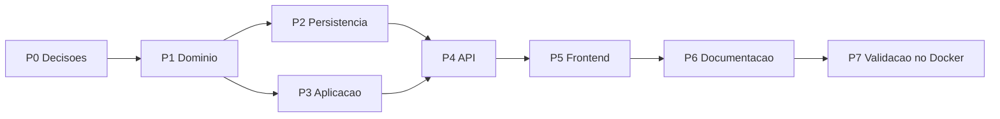

# Plano de Implementação — SPEC-016 Acesso rápido a assistentes na tela inicial

**Spec**: [SPEC-20261028-016](SPEC-016-acesso-rapido-a-assistentes-na-tela-inicial.md) (Aprovada em 2026-10-28)
**Status do plano**: Concluído em 2026-10-28 — P1 a P5 entregues; funcionamento confirmado pelo autor
**Data**: 2026-10-28
**Elaborado com apoio de IA generativa, pendente de revisão do autor**

## 0. Andamento

| Pacote | Situação em 2026-10-28 | Verificado por |
|--------|------------------------|----------------|
| P0 Decisões | Entregue: D1 = 4 e demais recomendações, escolhidas pelo autor em 2026-10-28 | Registro na SPEC |
| P1 Domínio | Entregue: `domain/home_assistants.py` (`MAX_HOME_ASSISTANTS` = 4, `HomeAssistantSelection`, `effective_home_assistants`, códigos de erro), porta `HomeAssistantPreferenceRepository` | CT-124 `test_home_assistants` (11) |
| P2 Persistência | Entregue: migração `0012_user_home_assistants`, `UserHomeAssistantModel`, `PostgresHomeAssistantPreferenceRepository` | CT-126 `test_home_assistants_storage` (Docker) |
| P3 Aplicação | Entregue: `manage_home_assistants.py` (`Get`/`SetHomeAssistantsUseCase`), `HomeAssistantsDTO`; log `home_assistants.saved` sem auditoria (RN-50) | CT-125 `test_home_assistants_use_cases` (10) |
| P4 API | Entregue: `GET`/`PUT /me/home-assistants`, 422 com o `code` da regra | CT-127 `test_home_assistants_api` (8) |
| P5 Frontend | Entregue: regras em `shared/home/home-assistants.ts`, modal `features/home/home-assistants-dialog.component.ts`, slice no store `nexus` (`applyDefaultAssistant` sem navegação), cartões com selo "Padrão", "Nova conversa" volta ao padrão | CT-128 (Vitest); confirmação do autor no navegador |
| P6/P7 | Funcionamento confirmado pelo autor em 2026-10-28; registro dos CT-124 a CT-130 na estratégia de testes e E2E CT-129 ficam para a próxima rodada | Autor |

## 1. Ordem de execução

Testes antes do código em cada pacote (ciclo SDD do `README.md` desta pasta).

## 2. Pacotes

| Pacote | Entrega | Arquivos | Testes | Pronto quando |
|--------|---------|----------|--------|---------------|
| P0 Decisões | Autor escolhe D1 a D8 e a SPEC passa a **Aprovada** | `SPEC-016-...md`, `README.md` desta pasta | — | Tabela de decisões com a escolha e a data |
| P1 Domínio | `MAX_HOME_ASSISTANTS`, `HomeAssistantSelection`, `EffectiveHomeAssistants`, `effective_home_assistants`, porta `HomeAssistantPreferenceRepository`; exportados em `domain/__init__.py` | `backend/src/domain/home_assistants.py`, `domain/interfaces.py` | CT-124 em `tests/unit/test_home_assistants.py`: limite 0/1/N/N+1, duplicado, padrão fora, filtro por visibilidade preservando ordem, padrão perdido, nada visível | `unittest` verde; `architecture-guard` sem bloqueante (domínio sem framework) |
| P2 Persistência | Migração `0012_user_home_assistants` (tabela, PK composta, FK `CASCADE`, índice único parcial do padrão; `downgrade` derruba a tabela); `UserHomeAssistantModel`; `PostgresHomeAssistantPreferenceRepository.replace` (apaga e insere na mesma transação) e `get` (ordena por `position`) | `infrastructure/database/alembic/versions/0012_user_home_assistants.py` (via `/new-migration user_home_assistants`), `database/models.py`, `database/repositories.py`, `infrastructure/composition.py` | CT-126 em `tests/integration/test_home_assistants_storage.py`: ida e volta, troca atômica, dois padrões barrados pelo índice, exclusão do assistente apaga a linha | Migração sobe e desce no Docker; CT-126 verde |
| P3 Aplicação | `GetHomeAssistantsUseCase`, `SetHomeAssistantsUseCase` com `Input` frozen e `HomeAssistantsDTO`; RN-48 pela `AccessPolicy`; log `home_assistants.saved` (RN-50) | `application/use_cases/manage_home_assistants.py`, `application/dto`, `use_cases/__init__.py` | CT-125 em `tests/unit/test_home_assistants_use_cases.py` com repositório em memória e `access_doubles.py`: sem preferência (D4), id sem acesso e inexistente → mesmo erro, usuário A não lê B | `unittest` verde |
| P4 API | `GET`/`PUT /me/home-assistants`; schemas Pydantic; erros de domínio → 422 `{detail, code}`; dependências em `api/dependencies.py` | `api/routes/me.py`, `api/schemas`, `api/error_codes.py`, `api/errors.py` | CT-127 em `tests/integration/test_home_assistants_api.py`: 401 sem token, 422 por código, isolamento entre usuários do realm de exemplo, perda de grupo (D8) | CT-127 verde no Docker; `ruff check --select F,E9` limpo |
| P5 Frontend | Métodos no `nexus-api.service.ts`; slice `homeAssistants` (actions, reducer, effects, `selectHomeAssistants`); `applyDefaultAssistant` (D5) no carregamento e em "Nova conversa"; regras puras; modal; cartões com selo "Padrão" e botão "Personalizar acesso rápido"; `topAssistants` do efetivo | `core/services/nexus-api.service.ts`, `store/nexus.*`, `shared/home/home-assistants.ts`, `features/home/home-assistants-dialog.component.ts`, `pages/chat-page.component.*`, `shell/shell.component.ts` | CT-128: `shared/home/home-assistants.spec.ts`, casos novos em `nexus.reducer.spec.ts` e `nexus.effects.spec.ts` (carrega após assistentes; `applyDefaultAssistant` não navega; salvar recarrega) | `npm test` e `npm run build` verdes |
| P6 Documentação | SPEC → Implementada; linha no `README.md` das specs; CT-124 a CT-130 em `estrategia-de-testes.md`; RF/RN nos documentos de especificação; tabela de rotas; skill `desenvolvedor-nexus` (migrações `0001` a `0012`, rota nova) | `docs/especificacao/*`, `.claude/skills/desenvolvedor-nexus/SKILL.md` | — | Revisão do autor |
| P7 Validação | Pilha no Docker: migração na subida, CT-126/127 sem pulos, E2E CT-129, CT-130 manual com capturas | `frontend/e2e/home-assistants.spec.ts`, `docs/qa/relatorios/2026-10-xx-spec-016/LEIAME.md` | CT-129, CT-130 | Relatório com evidências |

## 3. Decisões técnicas deste plano

- **Sem auditoria** (RN-50): a trilha append-only é de ação administrativa e de curadoria; gravar
  preferência pessoal nela poluiria a consulta da `/admin/audit`.
- **Limite no domínio, não no banco**: trocar a D1 depois não exige migração.
- **Sem id de usuário na rota**: `/me/...` usa só o `sub` do token, o que fecha o RF-106 por
  construção e dispensa checagem de dono.
- **`applyDefaultAssistant` separado de `selectAssistant`**: `selectAssistant` dispara o
  `navigateToChatEffect`; reaproveitá-lo no carregamento levaria um administrador em `/admin/audit`
  de volta ao chat ao recarregar a página.
- **Leitura tolera inconsistência** (D8): a perda de grupo não apaga a preferência; o filtro é
  feito a cada GET, contra `visible_assistants`, sem job de limpeza.

## 4. Estimativa

| Pacote | Esforço |
|--------|---------|
| P1 + P3 | ~0,5 dia |
| P2 + P4 | ~0,5 dia |
| P5 | ~1 dia |
| P6 + P7 | ~0,5 dia |
| **Total** | **~2,5 dias** |

## 5. Fora do escopo

- Reordenar cartões arrastando (D7).
- Limite configurável pelo administrador.
- Padrão definido pelo administrador para um grupo.
