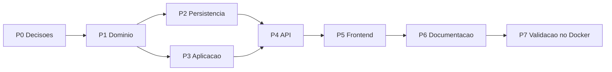

# Plano de Implementação — SPEC-017 Edição de nome, descrição e prompt do assistente

**Spec**: [SPEC-20261029-017](SPEC-017-edicao-de-nome-descricao-e-prompt-do-assistente.md) (Aprovada em 2026-10-29)
**Status do plano**: Concluído em 2026-10-29 — P0 a P6 entregues; P7 com CT-134, CT-135 e CT-137 aprovados e o CT-138 manual pendente.
**Data**: 2026-10-29
**Elaborado com apoio de IA generativa, pendente de revisão do autor**

## 0. Andamento

| Pacote | Situação em 2026-10-29 | Verificado por |
|--------|------------------------|----------------|
| P0 Decisões | Entregue: D1 = administrador e curador; D2 a D8 como recomendado (2026-10-29). Tamanhos gravados conferidos em 2026-10-29 (sessão somente leitura no PostgreSQL local): 7 assistentes, nome até 32, descrição até 50 e prompt até 1944 caracteres; nenhum acima de 500/4000, então a D3 vale sem exceção | Registro na SPEC; consulta do autor |
| P1 Domínio | Entregue em 2026-10-29: `domain/assistant_profile.py`, `AccessPolicy.can_edit_assistant`, `AuditAction.ASSISTANT_UPDATED`, porta `update_profile` | CT-131 (9 testes) |
| P2 Persistência | Entregue: `PostgresAssistantRepository.update_profile` sobre `_update_columns`; sem migração | CT-135 aprovado no PostgreSQL 16 (2/2) |
| P3 Aplicação | Entregue: `require_assistant_edit`/`can_edit_assistant`, `UpdateAssistantUseCase`, `AssistantDTO(reveal_prompt)`, listagem com D5, criação com `build_assistant_profile` | CT-132 (11), CT-133 (2); suíte unitária 899 com `ruff` limpo |
| P4 API | Código entregue: `PUT /assistants/{id}`, `UpdateAssistantRequest` (teto 20 000), handler 422 com `code`, criação com o mesmo 422 | CT-134 aprovado no container (10/10) |
| P5 Frontend | Entregue: `shared/assistants/assistant-profile.ts`, `updateAssistant` no serviço, actions/reducer/effect (`exhaustMap`), card `assistant-profile-settings` no topo de `/assistants`, `maxlength` no modal de criação | CT-136: `npm test` 221/221 |
| P6 Documentação | Entregue: CT-131 a CT-138 na estratégia, rota na SPEC-004, RN-21 em `regras-de-negocio.md`, C4 do backend e do frontend, `clean-architecture-backend.md`, `frontend-angular-ngrx.md`, skill `desenvolvedor-nexus`, passos 46 a 55 do roteiro manual, `frontend/e2e/README.md` | Revisão do autor |
| Correções da revisão (2026-10-29) | (1) a escolha automática voltou a receber o prompt de todos os candidatos: `ListAssistantsUseCase.inference_catalog`, usado por `POST /assistants/infer` (a D5 vale só para a listagem); (2) rótulo "Assistente alterado" na tela de auditoria; (3) RN-21 com o papel novo do curador; (4) erro da criação em português pelo `code` | Unitário novo no CT-132, teste de rota novo no CT-134, caso novo no CT-136 |
| P7 Validação | CT-134 e CT-135 aprovados em 2026-10-29 no container do backend (12 testes, nenhum pulado); CT-137 aprovado na pilha local (Playwright 5/5). **Pendente**: CT-138 manual (passos 46 a 55); avaliação do assistente piloto só se o prompt dele mudar | Pilha local |

## 1. Ordem de execução

Os testes vêm antes do código em cada pacote, pelo ciclo SDD do `README.md` desta pasta. A execução
segue `/spec-to-code SPEC-017`.

## 2. Pacotes

| Pacote | Entrega | Arquivos | Testes | Pronto quando |
|--------|---------|----------|--------|---------------|
| P0 Decisões | Autor escolhe D1 a D8; consulta somente leitura `SELECT max(length(description)), max(length(initial_prompt)) FROM assistants` no banco local (MCP `postgres`); SPEC passa a **Aprovada** | `SPEC-017-...md`, `README.md` desta pasta | — | Tabela de decisões com a escolha e a data |
| P1 Domínio | `MAX_ASSISTANT_DESCRIPTION`, `MAX_ASSISTANT_PROMPT`, validação com `code` em `Assistant`, `normalize_optional_text`, `assistant_profile_changes`, `AuditAction.ASSISTANT_UPDATED`, método `update_profile` na porta | `domain/entities.py`, `domain/value_objects.py`, `domain/audit.py`, `domain/interfaces.py`, `domain/__init__.py` | CT-131 em `tests/unit/test_assistant_profile.py` | `unittest` verde; `architecture-guard` sem item bloqueante |
| P2 Persistência | `PostgresAssistantRepository.update_profile` (UPDATE das três colunas com `RETURNING`; `None` se 0 linhas); sem migração | `infrastructure/database/repositories.py` | CT-135 em `tests/integration/test_assistant_profile_storage.py` | CT-135 verde no PostgreSQL 16 |
| P3 Aplicação | `require_assistant_edit` no `AccessControl` (D1); `UpdateAssistantUseCase` e `UpdateAssistantInput`; `AssistantDTO.from_entity(..., reveal_prompt)`; `ListAssistantsUseCase` com D5; `CreateAssistantUseCase` com `normalize_optional_text`; dublê `update_profile` no repositório em memória | `application/services/access_control.py`, `application/use_cases/update_assistant.py`, `use_cases/__init__.py`, `list_assistants.py`, `create_assistant.py`, `application/dto/assistant_dto.py`, `tests/unit/*_doubles.py` | CT-132, CT-133 | `unittest` verde |
| P4 API | `PUT /assistants/{assistant_id}`, `UpdateAssistantRequest`, códigos novos, 404 por `api/lookup.assistant_not_found`; `max_length` também no `CreateAssistantRequest` | `api/routes/assistants.py`, `api/schemas/assistants.py`, `api/error_codes.py` | CT-134 em `tests/integration/test_assistant_update_api.py` | CT-134 verde; `ruff check --select F,E9` limpo |
| P5 Frontend | `updateAssistant` no serviço; actions, reducer e effect no `nexus`; regras puras; card `assistant-profile-settings` no topo de `/assistants`, visível ao administrador e ao curador (D1); limites também no modal de criação | `core/services/nexus-api.service.ts`, `store/nexus.*`, `shared/assistants/assistant-profile.ts`, `features/assistants/assistant-profile-settings.component.ts`, `pages/assistants-page.component.*`, `shell/shell.component.*` | CT-136: `assistant-profile.spec.ts` e casos novos em `nexus.reducer.spec.ts` e `nexus.effects.spec.ts` | `npm test` e `npm run build` verdes |
| P6 Documentação | SPEC → Implementada; linha no `README.md`; CT-131 a CT-138 em `estrategia-de-testes.md`; RF-108 a RF-111 e RN-51 a RN-54 nos documentos de especificação; tabela de rotas e matriz de permissões da SPEC-004 (`PUT /assistants/{id}`, curador edita o assistente que cura); evento novo na lista de auditoria; skill `desenvolvedor-nexus` (rota e porta novas); passos no roteiro manual | `docs/especificacao/*`, `docs/arquitetura/*`, `docs/qa/validacao-manual-rag-enterprise.md`, `.claude/skills/desenvolvedor-nexus/SKILL.md` | — | Revisão do autor |
| P7 Validação | Pilha no Docker: CT-134 e CT-135 sem pulos; E2E CT-137; CT-138 manual com capturas; `scripts/eval.sh` do assistente piloto sem regressão além de 0,02 (SPEC-001) depois de editar o prompt | `frontend/e2e/assistant-edit.spec.ts`, `docs/qa/relatorios/2026-10-xx-spec-017/LEIAME.md` | CT-137, CT-138 | Relatório com evidências |

## 3. Decisões técnicas deste plano

- **`update_profile` em vez de `save`**: `save` faz `get` e, sem linha, cria. Se o assistente fosse
  excluído entre a leitura e a gravação, ele voltaria sem grupos e visível só a administradores, mas
  com id antigo e sem base. O UPDATE condicional fecha a RN-54 e segue o padrão de
  `update_llm_choice` e `update_retrieval_profile` (SPEC-013).
- **PUT com os três campos**, e não PATCH: o formulário sempre envia o estado inteiro, e o PUT é
  idempotente. A diferença para a auditoria é calculada no caso de uso.
- **Limite no domínio, repetido no Pydantic**: o domínio é a fonte da regra. O Pydantic só recusa
  corpos enormes antes de chegar a ele. Trocar a D3 depois não exige migração.
- **Hash do prompt na auditoria** (D6): prova que houve mudança e permite comparar com uma cópia
  guardada fora, sem pôr texto livre na trilha append-only.
- **Card próprio** em `features/assistants`, como os dois cards da SPEC-013: a página continua só
  compondo, e o componente só apresenta e despacha action.
- **Sem cache a invalidar**: o chat e a inferência leem o assistente do banco a cada pedido. O
  RF-109 já vale sem mudar o pipeline RAG, por isso o `rag-quality-reviewer` só revisa o CT-133.

## 4. Fora do escopo

- Histórico de versões do prompt e restauração.
- Controle otimista de concorrência (D7, alternativa com migração `0013`).
- Nome único entre assistentes (D8).
- Edição de assistente sem grupo pelo curador (fica só com o administrador).
