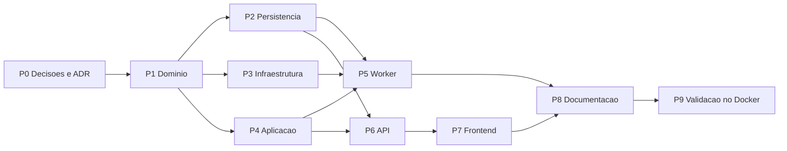

# Plano de Implementação — SPEC-018 Resumidor de documentos

**Spec**: [SPEC-20261030-018](SPEC-018-resumidor-de-documentos.md) (Aprovada em 2026-10-30)
**ADR**: [0014 — Documento pessoal e assistente de sistema](../../arquitetura/adrs/0014-documento-pessoal-e-assistente-de-sistema.md)
**Status do plano**: Aprovado para execução em 2026-10-30. Nenhum pacote começou.
**Data**: 2026-10-30
**Elaborado com apoio de IA generativa, pendente de revisão do autor**

## 0. Andamento

| Pacote | Situação em 2026-10-30 | Verificado por |
|--------|------------------------|----------------|
| P0 Decisões e ADR | Entregue: D1 a D43 como recomendado; SPEC **Aprovada**; ADR 0014 **Aceita** | Registro na SPEC e na ADR |
| P1 Domínio | A fazer | CT-139 a CT-142, CT-146 |
| P2 Persistência | A fazer | CT-149 |
| P3 Infraestrutura | A fazer | CT-148 |
| P4 Aplicação | A fazer | CT-142 a CT-145 |
| P5 Worker | A fazer | CT-144, CT-145, CT-149 |
| P6 API | A fazer | CT-147 |
| P7 Frontend | A fazer | CT-150 |
| P8 Documentação | A fazer | Revisão do autor |
| P9 Validação | A fazer | CT-147 a CT-152, avaliação de não regressão |

## 1. Ordem de execução

Os testes vêm antes do código em cada pacote, pelo ciclo SDD do `README.md` desta pasta. A execução
segue `/spec-to-code SPEC-018`, na branch `feat/spec-018-resumidor-de-documentos`. Por causa do
tamanho, o PR pode ser dividido em dois: **backend** (P1 a P6) e **frontend e validação** (P7 a P9).

## 2. Pacotes

| Pacote | Entrega | Arquivos | Testes | Pronto quando |
|--------|---------|----------|--------|---------------|
| P0 Decisões e ADR | D1 a D43 registradas; SPEC **Aprovada**; ADR 0014; linha no índice de SPECs; nota de complemento na ADR 0008 | `SPEC-018-*.md`, `README.md` desta pasta, `docs/arquitetura/adrs/0014-*.md`, `0008-*.md` | — | Feito em 2026-10-30 |
| P1 Domínio | `domain/document_summary.py`: constantes da RN-60 e da D22, `SUMMARIZER_ASSISTANT_ID`, `SummaryStage`, `SummaryProgress`, `SectionTokens`, `SummaryBatch`, `plan_summary_batches`, `target_summary_words`, `route_summarizer_message` com vocabulário fechado, `SummarizerCapabilities` e `summarizer_capabilities`. Também `PersonalScope(owner_user_id, conversation_id)`. Entidades: `Assistant.system_kind`, `Document.owner_user_id/conversation_id/expires_at`, `DocumentSummary`, `DocumentSummarySection`. `AccessPolicy`: assistente de sistema visível a todo papel e `can_use_personal_document`. `effective_home_assistants(pinned_id=...)` e `code` `home_assistant_pinned`. Portas `TokenCounter` e `DocumentSummaryRepository`; `VectorStoreGateway.hybrid_search(..., personal_scope)`. `AuditAction` com os 3 eventos. Erros `SystemAssistantReadonlyError`, `ConversationDocumentExistsError`, `SummaryDailyLimitError`, `DocumentTooLongError`, `SummaryNotReadyError` | `domain/document_summary.py` (novo), `domain/entities.py`, `domain/access.py`, `domain/home_assistants.py`, `domain/interfaces.py`, `domain/audit.py`, `domain/errors.py`, `domain/__init__.py` | CT-139, CT-140, CT-141, CT-146 e a parte de domínio do CT-142, em `tests/unit/test_document_summary.py`, `test_summarizer_routing.py`, `test_home_assistants.py` e `test_access_policy.py` | `unittest` verde; `ruff` limpo; `architecture-guard` sem item bloqueante (domínio sem framework) |
| P2 Persistência | Migração `0013_document_summarizer` pelo `/new-migration`: `assistants.system_kind` com índice único parcial e `INSERT` idempotente do resumidor; `documents.owner_user_id/conversation_id/expires_at`, status `expirado`, check da T7, índices; `ingestion_jobs.kind` com `summarize`; tabelas `document_summaries` e `document_summary_sections`; `usage_records.operation` com padrão `chat`. Modelos SQLAlchemy, `PostgresDocumentSummaryRepository`, mapeamentos novos em `PostgresDocumentRepository` e `PostgresAssistantRepository`, contagem da cota (T8), filtro `operation='chat'` nos limites (RN-65) | `infrastructure/database/alembic/versions/0013_document_summarizer.py`, `models.py`, `repositories.py`, `operations_repositories.py`, `home_assistants_repository.py` | CT-149 em `tests/integration/test_document_summarizer_storage.py` | Migração sobe e desce no PostgreSQL 16 sobre a base da rc9; rodar duas vezes não duplica o resumidor; CT-149 verde |
| P3 Infraestrutura | `LocalTokenCounter` sobre o tokenizador de `sentence_transformer_embedding.py`, sem truncamento, com `MODEL_LOAD_LOCK` e a trava por modelo. `QdrantVectorStoreGateway`: índices de payload `owner_user_id` e `conversation_id` no `ensure_collection`, `_payload` com os dois campos, `_filter` com `personal_scope`. `structural_chunker.split_sections()` devolvendo seções (título, página inicial, texto) para o resumo (T5) | `infrastructure/embeddings/token_counter.py` (novo), `infrastructure/vector_store/qdrant_store.py`, `infrastructure/chunking/structural_chunker.py`, `infrastructure/composition.py` | CT-148 em `tests/integration/test_personal_scope_qdrant.py`; unitário de `split_sections` | CT-148 verde no Qdrant 1.11.3 da pilha |
| P4 Aplicação | `application/use_cases/summary_documents.py`: `UploadSummaryDocumentUseCase`, `GetSummaryDocumentStatusUseCase`, `GetStoredSummaryUseCase`, `RetrySummaryUseCase` e `PurgeExpiredSummaryDocumentsUseCase`. `application/services/document_summary_prompts.py` (`SUMMARY_PROMPT_VERSION`, mini-resumo, consolidação, sob medida). `application/services/document_summary.py` (`HierarchicalSummarizer`, `tailored_summary` e o pós-resumo da T4). `chat_with_assistant.py` com o roteamento da RN-61 antes do grafo (T3) e o `personal_scope` na rota 5, com a guarda de falha fechada (T2). `ManageConversationUseCase.delete` apaga o documento pessoal antes da conversa. Guardas da RN-55 em exclusão, edição de perfil, perfil de recuperação e envio para a base. `ListAssistantsUseCase` com `is_system`; `inference_catalog` sem o resumidor. `ManageHomeAssistantsUseCase` com `pinned_id`. Dublês em memória das portas novas | `application/use_cases/*.py` citados, `application/services/*.py` citados, `application/dto/*.py`, `application/services/access_control.py`, `tests/unit/fakes*` | CT-142, CT-143, CT-144 (com dublês), CT-145 em `tests/unit/test_summary_documents.py` e `test_hierarchical_summarizer.py`; ajuste dos testes da SPEC-014, 016 e 017 tocados | Suíte unitária inteira verde (a linha de base é 900); `rag-quality-reviewer` revisa o roteamento e os prompts |
| P5 Worker | `process_ingestion.py`: no documento pessoal, contagem antes dos embeddings, falha definitiva `document_too_long`, payload pessoal e enfileiramento do `summarize`. `cli/worker.py`: despacho de `kind='summarize'` para o `HierarchicalSummarizer`, progresso gravado a cada lote, limpeza de expirados a cada hora (T9) | `application/use_cases/process_ingestion.py`, `cli/worker.py`, `infrastructure/composition.py` | CT-144 e CT-145 (fluxo com dublês); CT-149 (limpeza no banco real) | Um documento fictício de ponta a ponta no container chega a `pronto` com a mensagem postada |
| P6 API | Rota `GET /summarizer`; `POST/GET /conversations/{id}/document`; `GET /conversations/{id}/summary`; `POST /conversations/{id}/summary/retry`. Schemas Pydantic; códigos novos em `api/error_codes.py`; 409 `system_assistant_readonly` nas rotas existentes; 404 em conversa alheia; upload pelo `read_upload` atual (413) | `api/routes/summarizer.py` (novo), `api/routes/conversations.py`, `api/routes/assistants.py`, `api/routes/assistant_settings.py`, `api/routes/documents.py`, `api/schemas/*.py`, `api/error_codes.py`, `api/dependencies.py`, `api/main.py` | CT-147 em `tests/integration/test_summarizer_api.py` | CT-147 verde no container; `ruff` do CI limpo |
| P7 Frontend | Serviço (`getSummarizer`, `uploadConversationDocument`, `getConversationDocument`, `getStoredSummary`, `retrySummary`). Store: estado `summarizer` e `conversationDocument`, polling de 3 s até estado final, recarga das mensagens em `pronto`. Composer com clipe e área de soltar só com o resumidor ativo; chip de etapa e progresso com "Resumir" e "Tentar resumir de novo". Boas-vindas renderizadas de `welcome_markdown`. Cartão fixo com selo "Sistema" no acesso rápido e no modal (sem caixa de marcação, com botão de padrão). `/assistants`: o resumidor só com o card de LLM e sem lixeira. Regras puras em `shared/summarizer/summarizer.ts` | `core/services/nexus-api.service.ts`, `store/nexus.*.ts`, `shared/summarizer/` (novo), componentes do chat, da tela inicial, do modal de acesso rápido, da barra lateral e de `/assistants` | CT-150 (Vitest) | `npm test` verde; `ngc` sem erro; build no CI |
| P8 Documentação | Matriz de permissões da SPEC-004; nota na SPEC-014, 016 e 017 com a exceção e o novo padrão de recuo; RN novas em `regras-de-negocio.md`; C4 do backend e do frontend; `rag-e-isolamento-de-conhecimento.md` (escopo pessoal); `clean-architecture-backend.md`; `frontend-angular-ngrx.md`; `CLAUDE.md` com o complemento da RN-59; skill `desenvolvedor-nexus` (assistente de sistema, documento pessoal, ADR 0014); passos novos no roteiro manual; 3 documentos fictícios gerados por script (T10) | `docs/**` citados, `CLAUDE.md`, `.claude/skills/desenvolvedor-nexus/SKILL.md`, `backend/tests/fixtures/summarizer/` e `scripts/gerar_documentos_resumidor.py` (novos) | — | Revisão do autor |
| P9 Validação | CT-147 a CT-149 no container; CT-151 no Playwright, com o tempo total registrado (RNF-40); CT-152 manual; avaliação de não regressão do RAG (`scripts/eval.*` do assistente piloto, tolerância de 0,02 da SPEC-001), porque o filtro da busca mudou; relatório em `docs/qa/relatorios/2026-10-xx-spec-018/LEIAME.md` | `frontend/e2e/summarizer.spec.ts` (novo), `docs/qa/relatorios/...` | CT-147 a CT-152 | Todos aprovados ou com ressalva registrada; SPEC passa a **Implementada** |

## 3. Decisões técnicas deste plano

- **T1 — Uma collection para todos os documentos pessoais.** `assistant_{SUMMARIZER_ASSISTANT_ID}`,
  com índices de payload em `owner_user_id` e `conversation_id` (ADR 0014, item 3). A collection é
  criada sob demanda no primeiro envio, pelo `ensure_collection` atual.
- **T2 — Falha fechada em duas camadas.** (1) A aplicação: quando o assistente é o resumidor e não
  há `PersonalScope`, levanta `AccessDeniedError` antes de chamar o gateway. (2) O gateway: na
  collection do resumidor, `personal_scope=None` levanta `ValueError`. O CT-148 cobre a segunda e o
  CT-142 a primeira. Os assistentes comuns nunca recebem `personal_scope`, então o caminho deles não
  muda (a avaliação de não regressão no P9 confirma).
- **T3 — Roteamento antes do LangGraph.** As rotas 1 a 4 da RN-61 não passam pelo grafo: não têm
  recuperação nem fallback de relevância, e o grafo continuaria a ser chamado só para ser
  contornado. A rota 5 usa o grafo atual sem mudança de forma, só com o `personal_scope` e o perfil
  fixo da D35. Isso mantém a ADR 0002 e não agrava a ressalva do RNF-11 (LangGraph na aplicação).
- **T4 — Postagem automática pelo worker.** No fim do `summarize`, o worker grava uma mensagem
  `assistant` na conversa pelo `ConversationRepository`, com as citações no formato atual
  (`messages.citations`). O frontend não recebe push: o polling de 3 s vê `pronto` e recarrega as
  mensagens. Se a conversa foi excluída no meio, o job termina sem postar e a limpeza segue.
- **T5 — Seções para o resumo vindas do parser.** `structural_chunker` já detecta títulos para o
  prefixo dos chunks. `split_sections()` devolve essas seções inteiras (título, página inicial e
  texto) sem o corte de 128 tokens. `plan_summary_batches` (domínio) recebe só as contagens e
  devolve os lotes; o texto não entra no domínio.
- **T6 — Id fixo do resumidor.** `SUMMARIZER_ASSISTANT_ID = "system-document-summarizer"` no
  domínio e no `INSERT` da migração. Credencial nula = segue a padrão (ADR 0013, item 3).
- **T7 — Correção da SPEC no check de `documents`.** A SPEC diz "ambos nulos ou ambos preenchidos",
  mas a lápide (ADR 0014, item 6) fica com `conversation_id` nulo depois da exclusão da conversa
  (`ON DELETE SET NULL`). O check correto é `conversation_id IS NULL OR owner_user_id IS NOT NULL`
  (conversa só com dono). O P0 ajusta o texto da SPEC; não muda nenhuma decisão.
- **T8 — Cota pela tabela `documents`.** `count(*) WHERE owner_user_id = :u AND created_at > now() -
  interval '24 hours'`, com o índice `(owner_user_id, created_at)`. Lápides e falhas contam, como
  pede a RN-60. Sem tabela nova.
- **T9 — Limpeza a cada hora no worker.** Sem agendador novo: o laço do worker roda
  `PurgeExpiredSummaryDocumentsUseCase` quando passou 1 h da última execução. A ordem é vetores →
  original → seções e resumo → status `expirado` → auditoria. Cada passo é idempotente, e uma falha
  no Qdrant deixa o documento para a próxima rodada.
- **T10 — Documentos de teste fictícios e gerados.** Um script gera um contrato em DOCX, um
  relatório em PDF (com uma página só em imagem para o OCR) e uma ata em TXT, todos com conteúdo
  inventado, mais um PDF de cerca de 40.000 tokens e um DOCX de cerca de 52.000 para o teto. Nenhum
  documento real é usado (`CLAUDE.md`).
- **T11 — Ambiente sem PyPI e npm.** Nenhuma dependência nova é necessária: tokenizador, extração,
  OCR, LLM e fila já existem. Os testes unitários rodam fora do Docker com o dublê de `langgraph`
  já usado; integração e E2E rodam pelo comando para o autor, registrado nas notas do projeto.

## 4. Fora do escopo

- Tabelas financeiras estruturadas (D40; continua a limitação da PC-D7).
- Vários documentos por conversa e comparação entre documentos (D8, D41).
- Avaliação automática do resumo no estilo da SPEC-001 (D42).
- Baixar o resumo como `.docx` ou `.pdf` (D43).
- Troca do modelo de embeddings e chunks de 500 a 1.000 tokens (escolha A).
- Envio de documento pessoal para outros assistentes que não o resumidor.
- Notificação por push quando o resumo fica pronto (o polling cobre a tela aberta).
